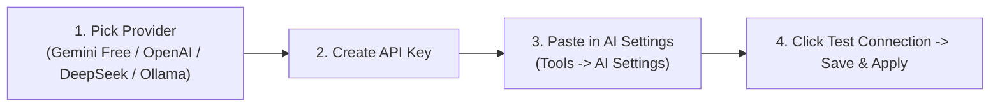

# AI API Keys & Accounts Setup Guide

PTView AI Copilot uses **Bring Your Own Key (BYOK)**: you connect your own API key from Google Gemini, OpenAI, DeepSeek, OpenRouter, or run **Ollama** 100% free and offline on your computer. Your API keys are stored **only on your local machine** and never uploaded to any PTView server.




---

## Option 1: Google Gemini (Free Tier Available — Recommended)

Google offers a generous free API tier with fast `gemini-2.5-flash` responses — ideal for everyday chart analysis.

1. Open **[Google AI Studio](https://aistudio.google.com/apikey)** and sign in with your Google account.
2. Click **Create API key** (choose an existing Google Cloud project or create a new one in 1 click).
3. Copy the generated key (starts with `AIza...`).
4. In PTView, open **Tools → AI Settings…** → **AI Accounts** tab.
5. Click **Add** to create your first account (or click **Configure AI Account** directly from the AI Copilot onboarding card), and set:
   - **AI Provider**: `Google Gemini (Official / Recommended)`
   - **API Key / Auth Token**: Paste your `AIza...` key
   - **Model ID**: `gemini-2.5-flash` (or click **Fetch Models** to pick another)
6. Click **Test Connection** → verify green success message → click **Save & Apply**.

---

## Option 2: OpenAI (ChatGPT API)

1. Go to **[OpenAI Platform API Keys](https://platform.openai.com/api-keys)** and sign in.
2. Make sure billing credits are active under **Settings → Billing**.
3. Click **+ Create new secret key**, name it `PTView`, and copy the `sk-...` key.
4. In PTView **Tools → AI Settings…**:
   - **AI Provider**: `OpenAI / OpenAI-Compatible`
   - **API Key / Auth Token**: Paste your `sk-...` key
   - **Model ID**: `gpt-4.1-mini` or `gpt-4o` (or click **Fetch Models**)
5. Click **Test Connection** → **Save & Apply**.

---

## Option 3: DeepSeek

1. Sign in at **[DeepSeek Platform](https://platform.deepseek.com/api_keys)** and top up API balance.
2. Click **Create new API key** and copy it.
3. In PTView **Tools → AI Settings…**:
   - **AI Provider**: `DeepSeek`
   - **API Key / Auth Token**: Paste your key
   - **Model ID**: `deepseek-chat` (or `deepseek-reasoner`)
4. Click **Test Connection** → **Save & Apply**.

---

## Option 4: OpenRouter (One Key for 100+ Free & Paid Models)

1. Sign in at **[OpenRouter Keys](https://openrouter.ai/keys)** and click **Create Key**.
2. In PTView **Tools → AI Settings…**:
   - **AI Provider**: `OpenRouter`
   - **API Key / Auth Token**: Paste your `sk-or-...` key
   - Click **Fetch Models** to browse both free (`:free`) and paid models (Claude, Llama, Gemini, GPT).
3. Click **Test Connection** → **Save & Apply**.

---

## Option 5: Ollama (100% Free & Offline Local Models)

Run AI completely offline on your own GPU/CPU with zero API costs:

1. Install **[Ollama](https://ollama.com/download)** for Windows.
2. Open PowerShell or Command Prompt and download a tool-calling capable model:
   ```powershell
   ollama pull qwen2.5:7b
   ```
3. Make sure Ollama is running (`ollama serve` or system tray icon).
4. In PTView **Tools → AI Settings…**:
   - **AI Provider**: `Ollama (Local)`
   - **API Key / Auth Token**: Leave blank (or type `ollama`)
   - **Custom API Base URL**: `http://localhost:11434/v1`
   - Click **Fetch Models** and pick `qwen2.5:7b`
5. Click **Test Connection** → **Save & Apply**.

---

## Adding Backup Accounts (Automatic Rate-Limit Failover)

If you use a free-tier key that hits rate limits during busy sessions, add 1 or 2 backup accounts:
1. Click **Add** (or **Duplicate**) in **AI Accounts** to add a second Gemini key or fallback provider (e.g. OpenRouter/DeepSeek).
2. Switch to the **Common & Failover** tab in **AI Settings** and keep **Auto-switch account on quota/network failure** enabled.
3. PTView automatically switches to your backup account during temporary errors or 429 rate limits and cools down the primary key before retrying.

:::tip Security & Privacy
API keys are never sent to PTView servers and are automatically masked by `SecretRedactor` if you ever export a Diagnostics `.zip` log bundle.
:::

