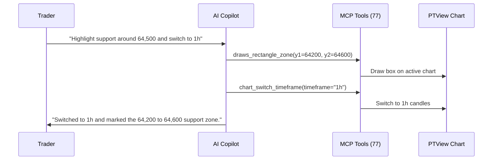

# AI Copilot & Chat Commands

PTView includes a built-in **AI Copilot** (<kbd>Ctrl</kbd> + <kbd>J</kbd>) that lets you ask questions about market structure, attach indicators, draw support/resistance zones, and schedule background checks in plain language.

:::note Read-Only Trading Safety
PTView is strictly an analytical charting workstation. Order placement and live exchange trading tools are intentionally excluded from both the in-app AI Copilot and external MCP endpoints.
:::

:::warning AI Limitations & Risk Disclaimer
AI models can hallucinate or misread market structures. Always verify chart levels and market data independently before trading — read the full [Trading Risk & AI Copilot Disclaimer](../legal/risk-and-ai-disclaimer.md).
:::

---

## 1. How to Connect Your First AI Account (3 Steps)

PTView uses **Bring Your Own Key (BYOK)** — you can use free cloud tiers or run models 100% locally on your PC:

1. If you haven't added an account yet, the AI Copilot sidebar prompts you to **Configure AI Account** (or open **Tools → AI Settings** → **AI Accounts**).
2. Click **Add Account**, choose a provider, and paste your API Key:
   - **Google Gemini (Free tier available)**: Create a free key in [Google AI Studio](https://aistudio.google.com/apikey) and pick `gemini-2.5-flash`.
   - **OpenAI / DeepSeek / OpenRouter / Anthropic**: Select the provider, paste your API key, and select a model.
   - **Ollama (100% Free & Offline)**: Run `ollama serve` locally, set Base URL to `http://localhost:11434/v1`, and pick your local model.
3. Click **Test Connection** → **Save**. You can also add multiple accounts so PTView automatically fails over if one key hits a rate limit.

:::tip Detailed Setup Guides
- Need help creating a key? Follow **[AI API Keys & Accounts Setup](./ai-api-keys-setup.md)** (step-by-step for Google AI Studio, OpenAI, DeepSeek, OpenRouter, and Ollama).
- Want alerts sent to your phone? Follow **[Telegram Bot Alerts Setup](./telegram-bot-setup.md)**.
:::

---

## 2. How AI Copilot Interacts with Your Chart

---

## 3. Everyday Chat Features

### Active Workspace & Chart Context Locks
By default, AI Copilot automatically knows which workspace tab, grid layout, pair, and timeframe you are viewing:
- **Workspace Tab Awareness**: AI identifies your active tab (e.g. `Tab 1 of 3: "BTC MTF"`, `Layout: SplitVertical, 2 panes`) and can switch the active chart's symbol/exchange (`OKX`, `Binance`, `Bybit`), switch tabs, create new tabs, or alter multi-pane layouts on demand.
- **Symbol Lock ON**: Ask *"What is the RSI right now?"* without typing `BTC/USDT` every time.
- **Timeframe Lock ON**: Defaults to the active chart timeframe; untick it when asking for multi-timeframe (`15m`, `1h`, `4h`, `1d`) analysis.

### Chat Input Card: `+` Menu, Model Picker & Monthly Usage
The chat input footer gives you instant control without leaving the sidebar:
- **`+` Quick Action Menu**: Open **Actions** (`/`), **MCP Tools** (`#` — all **77 MCP tools** such as `#market_get_candles`, `#indicators_add`, `#draws_horizontal_line`, `#workspace_switch_symbol`, `#workspace_switch_tab`, `#notify_send`), **`⚡` Quick Ask** templates (customizable under **AI Settings → Quick Ask**), and **Symbol / Timeframe Locks**.
- **Model Picker**: Click the active model pill in the footer to switch models on the fly (using curated presets or live remote model discovery from your provider).
- **Monthly Usage**: Click the token usage badge to view cumulative monthly token usage and per-provider breakdowns.

### Quick Ask Templates (`⚡`)
Click the **`⚡`** button in the chat toolbar to launch **21 built-in one-click prompts** spanning technical analysis, derivatives (OI/funding/sentiment), indicator setup & scans, auto-Fibonacci/supply-demand drawings, breaking news, and workspace snapshots:
- **Find Fast**: Filter by **Scope** (*Workspace* / *Global* / *All*), **Category** (*TA & Chart*, *Derivatives*, *Indicators*, *Drawing*, *Intel & News*, *Workspace*), or type keywords / `#tool` names in the search box.
- **Customize**: Create, edit, or reorder your own templates under **AI Settings → Quick Ask** using `{symbol}` and `{timeframe}` placeholders (automatically filled from your active chart).

### Scheduled Background Monitoring (`/schedule`)
Let AI monitor markets on autopilot and notify you via Telegram or the status bar:
- **Recurring Check**: `/schedule every 15m check RSI and key support levels --notify`
- **Finite Repeat (`--repeat` / `xN`)**: `/schedule every 30m --repeat 3 monitor funding rate and open interest`
- **One-Shot Reminder (`in` / `once`)**: `/schedule in 10m inspect 4h candle close --notify`
- **Manage Jobs**: `/schedule list`, `/schedule run 1`, `/schedule pause all`, `/schedule resume all`, `/schedule cancel 1`

:::info Background Job Safety
Scheduled jobs run strictly in **read-only mode** — they can fetch prices, funding rates, indicators, and send notifications, but they never alter your chart drawings or layout. Manage scheduler defaults under **AI Settings → Common**.
:::

---

## 4. Complete Slash Command Reference (21 Commands)

Type `/` in the AI Chat box to open the command palette:

### Session & Schedule Management
| Command | Aliases | Description |
|---|---|---|
| `/new` | `/n` | Start a new conversation session |
| `/clear` | `/cls`, `/c` | Clear all messages in the current session |
| `/resume [id\|title]` | `/open` | Switch to a recent session |
| `/rename <new_title>` | `/title` | Rename the current conversation session |
| `/delete` | `/del`, `/rm` | Delete the current conversation session |
| `/export [md\|json] [path]` | `/save`, `/dump` | Export conversation to Markdown or JSON |
| `/compact [instructions]` | `/summarize` | Summarize history to free context window |
| `/schedule [every\|in\|list\|run\|pause\|resume\|cancel]` | `/cron`, `/timer` | Schedule or manage read-only background AI monitoring jobs |

### Generation Control & Notifications
| Command | Aliases | Description |
|---|---|---|
| `/stop` | `/abort`, `/cancel` | Stop the active AI response or tool run |
| `/retry` | `/r`, `/regen` | Re-send the last user message |
| `/notify [on\|off\|status\|bot <alias>]` | `/telegram`, `/tg` | Toggle or check Telegram notifications |

### Tools & Approvals
| Command | Aliases | Description |
|---|---|---|
| `/tools [filter]` | `/mcp` | List all 77 MCP tools or filter by keyword |
| `/autoapprove [on\|off]` | `/approve` | Toggle automatic approval for low-risk chart actions |

### System, Accounts & Context
| Command | Aliases | Description |
|---|---|---|
| `/help [command]` | `/h`, `/?` | Show slash command help |
| `/status` | `/info` | Show active AI account, model, chart context, and Telegram state |
| `/scope` | — | Show active symbol and timeframe locks |
| `/account [ai\|tele [target]]` | `/acc` | List or switch active AI account or Telegram bot |
| `/model [model_id\|reset]` | `/m` | Override model ID for this session |
| `/context` | `/ctx` | Inspect context window token usage |
| `/usage` | `/tokens`, `/stats` | Display token usage statistics |
| `/logs [lines]` | `/log` | Inspect recent AI & MCP logs |

---

## 5. Example Prompts You Can Copy & Try

- *"Add EMA 20 in yellow, EMA 50 in blue, and RSI(14) below the chart."*
- *"Find the major swing high and swing low on 4h and draw a Fibonacci Retracement."*
- *"What is today's Fear & Greed Index and Binance BTC funding rate?"*
- *"Analyze the 1h market structure and send a brief summary to my Telegram."*
- *"Switch the current chart to OKX BTC-USDT-SWAP and check the latest price."*
- *"Switch to tab 2 and change layout to Split Vertical."*
- *"Open a new tab for SOL-USDT-SWAP on 4h named 'Solana Watch'."*

:::tip Connect External AI Agents (VS Code, Cursor, Claude)
Want VS Code Copilot, Cursor, Claude Desktop, or Antigravity to control PTView charts directly? See the **[MCP Server & 77-Tool Reference](./mcp-server-and-tools.md)**.
:::
