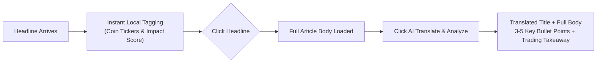

# Breaking News & AI Market Pulse

Stay on top of market-moving crypto and macro headlines without leaving your chart. PTView's **Breaking News** dock lives directly below your chart workspace, combining live news feeds, full-article reading, one-click AI translation & impact summaries, and customizable Toast alerts.

:::tip Free to Use — AI Optional
You can read live headlines, filter by coin or sentiment, and view full articles right out of the box. Connect an AI account (including free tiers or local Ollama) whenever you want **AI Translation**, **Key Bullet Points**, and **Market Impact Scores**.
:::

---

## 1. Opening & Resizing the Breaking News Panel

You can show or hide the Breaking News panel anytime:
- Press **<kbd>Ctrl</kbd> + <kbd>B</kbd>**, or
- Open **View → Breaking News Panel** from the top menu, or
- Click the **Breaking News** icon on the top-right toolbar (which displays a live unread badge — capped at `99+` and highlighted in orange-red when urgent Breaking/High-Impact stories arrive), or
- Click the **`News: N`** pill on the bottom-right **Status Bar** (visible whenever new unread headlines arrive; clicking it immediately opens the Breaking News panel).

### Flexible Layout Controls
- **Resize Height**: Drag the horizontal splitter bar between the chart and the Breaking News panel.
- **Maximize Over Chart**: Click the **Maximize** icon (`⛶`) on the right side of the Breaking News tab bar — or **double-click the `Breaking News` tab title** — to expand the panel across 100% of the chart area for comfortable reading. Click **Restore** (or double-click again) to return to your chart.
- **1/3 List & 2/3 Reader (or Full-Width List)**: By default, headlines take 1/3 on the left and the full article reader takes 2/3 on the right. Click the **Toggle Reader Pane** button to hide the right pane and browse headlines at full width; double-click any headline to open the reader again.

---

## 2. Filtering Headlines & Navigating to Charts

Use the compact toolbar at the top of the panel to focus on what matters:

| Filter / Control | What It Does |
|---|---|
| **All** | Shows all recent articles across your enabled feeds. |
| **Breaking** | Highlights high-impact and urgent market-moving stories. |
| **Chart** | Automatically filters news matching the active coin on your chart (e.g., `BTC`, `ETH`, `SOL`). |
| **Bullish / Bearish** | Filters by detected market sentiment. |
| **Source Dropdown & Search** | Filter by a specific publisher or search by keyword/ticker. |
| **Coin Pills (`BTC`, `ETH`...)** | Click any coin badge on an article to jump your chart directly to that symbol. |

---

## 3. Full-Article Reading & AI Translation

Inside the right-hand reader pane, you have a compact icon toolbar:
- **AI Translate & Analyze**: Translates the headline, summary, and **entire article body** into your chosen language, while generating **3–5 Key Bullet Points**, an **Impact Score (1–10)**, and an **AI Takeaway**.
- **Switch Original / Translated**: Toggle between the translated version and the original source text in one click.
- **Reload Full Article**: Re-fetch the full article text from the publisher's page if only a short preview was included in the feed.
- **Send to AI Copilot**: Send the full article directly to **AI Copilot** (<kbd>Ctrl</kbd> + <kbd>J</kbd>) to ask follow-up questions against your live chart.
- **Copy Link / Copy Full Content / Open in Browser**: Copy the URL or full formatted article text, or open the original publisher page in your browser.

:::note Scrollable AI Insight Card
When an article includes a detailed AI analysis, the **AI Insight & Key Points** card has its own smooth scroll area. Once you scroll to the top or bottom of the AI card, scrolling continues seamlessly through the full article below.
:::

---

## 4. Quick Settings Flyout & Custom News Sources

Click the **Quick Settings** button (with the active language badge such as `VI` or `EN`) on the Breaking News toolbar to adjust preferences without leaving your workspace:
- **Target Translation Language**: Choose *Match App Language* or pick a specific language (Vietnamese, English, Japanese, Korean, Chinese, Spanish, French, German).
- **Auto AI Translate**: Off by default so you stay in control of AI usage. Enable it anytime and choose **Breaking & High-Impact Only** or **All New Items**.
- **Auto-Load Full Content on Select**: Automatically loads the full article body when you click a headline.
- **Breaking News Toast Alerts**: Turn desktop/in-app news toast popups on or off.

### Managing Feeds in Settings → News & Feeds

Click the **Settings** gear icon on the Breaking News toolbar (or go to **Tools → Settings → News & Feeds**) to:
- Enable or disable built-in crypto and market feeds.
- **Add Custom Sources**: Paste any RSS, Atom, or JSON Feed URL, set its polling interval, and click **Test Feed** before saving.
- Enable **Forward AI-Summarized News to Telegram** and verify delivery using the built-in sample test button.

---

## 5. AI-Summarized News Alerts on Telegram

Beyond reading in the bottom dock, PTView can automatically summarize key points, translate headlines into your chosen language, and forward important market stories straight to your Telegram chat or group.

### Quick 3-Step Setup
1. **Connect a Telegram Bot**: Add and enable at least one bot under **Settings → Notifications** (see [Telegram Bot Setup](telegram-bot-setup.md)). When 2 or more bots are enabled, you can assign **one dedicated bot specifically for News** or follow the global default bot.
2. **Connect an AI Account**: Ensure at least one AI provider account is enabled in **AI Settings** for translation and takeaway generation. On **Pro Edition**, having 2+ enabled AI accounts unlocks automatic failover rotation if an API account hits rate limits (HTTP 429).
3. **Configure Filters & Test**: Under **Settings → News & Feeds** (or **Notifications → Breaking News**):
   - Choose the **Minimum Impact Threshold** (*Low*, *Medium*, *High — Default*, or *Critical Only*).
   - Optionally enable **Filter by Watchlist / Active Chart** so only articles touching your tracked coins arrive on Telegram.
   - Click **Send Sample News to Telegram** to test message formatting immediately.

### One-Click Manual Sharing
- From the article reader toolbar or any headline's right-click menu, click **Send AI Summary to Telegram** to summarize, translate (if needed), and deliver that specific article on demand.
- Once an article has been delivered successfully to a Telegram bot account, PTView remembers it across restarts so the exact same story will not be sent again—unless you switch to a different Telegram bot or update its token / chat ID in Settings.

:::tip If No AI Account Is Configured Yet
To keep your Telegram feed clean, automatic background forwarding pauses with a reminder toast when zero AI accounts are enabled. When sending an article manually without AI, you can click **Send Original** right from the prompt—or enable **Send Original Excerpt If AI Unavailable** in Settings.
:::
