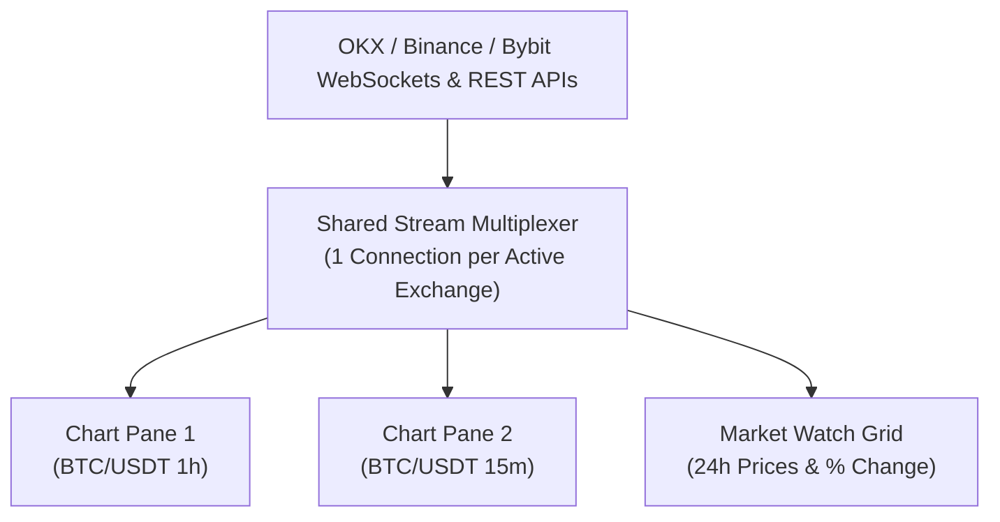

# Exchanges & Market Data

PTView connects directly to **3 core cryptocurrency exchanges** (`OKX`, `Binance`, and `Bybit`) via `CryptoClients.Net` to stream real-time candlesticks, 24h tickers, and order book depth — **no exchange API keys required for market data**.

---

## Supported Exchanges (`OKX`, `Binance`, `Bybit`)

`OKX`, `Binance`, and `Bybit` are enabled by default on first launch. You can enable or disable any of these 3 exchanges anytime in **Setup Wizard** or **Settings → Exchanges**:

| Market Coverage | Supported Exchanges |
|---|---|
| **Spot + Perpetual + Delivery** | `OKX`, `Binance`, `Bybit` |

:::info Independent Client Disclaimer
PtView Workstation is independent technical analysis software and is **not affiliated with, endorsed by, or sponsored by OKX, Binance, or Bybit**. Public market feeds are retrieved directly from your device via each exchange's official APIs subject to their respective terms of service; features and supported exchanges may change in accordance with exchange terms.
:::

---

## How PTView Streams Data (Shared Multiplexer)

Instead of opening separate WebSocket connections for every chart window, PTView shares a single multiplexed stream per exchange across all charts and Market Watch:

- **Zero Duplicate Bandwidth**: Opening 4 charts of the same symbol uses the exact same network bandwidth as opening 1 chart.
- **Automatic Gap Recovery**: If your Wi-Fi or VPN drops briefly, PTView automatically detects missing candles and backfills them via REST when reconnected.

---

## Using Market Watch & Quick Symbol Search

- **Toggle Market Watch (<kbd>Ctrl</kbd> + <kbd>M</kbd>)**: Filter by exchange, market type (**ALL**, **SPOT**, **PERP**, **INVERSE**), or click the search icon to filter pairs live.
- **Right-Click Actions**: Open any pair in the active chart or in a new chart tab, copy ticker symbol, or customize visible columns (`Last`, `24h %`, `24h High`, `24h Low`, `24h Vol`, `Exchange`).
- **Quick Symbol Search (<kbd>Ctrl</kbd> + <kbd>K</kbd>)**: Jump to any pair across all enabled exchanges without leaving the chart.

---

## Optional: Exchange API Keys & Network Proxy

1. Open **Settings** (<kbd>Ctrl</kbd> + <kbd>P</kbd>) → **Exchanges**.
2. Toggle which exchanges appear in Market Watch and Quick Search.
3. If your network blocks certain exchanges, scroll to **Network Proxy**, enable **HTTP / SOCKS5 Proxy**, enter Host & Port, and click **Save** (applies immediately without restart).

:::tip No API Key Needed for Charts
Viewing live candlesticks, order books, funding rates, and open interest works **without any exchange API keys**. Only add read-only exchange API keys if you plan to inspect private account balances.
:::
