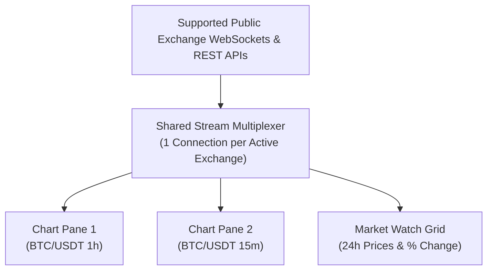

# Multi-Exchange Market Data

PTView connects directly from your workstation to **multiple supported cryptocurrency exchanges** via `CryptoClients.Net` to stream real-time candlesticks, 24h tickers, and order book depth using **public market endpoints only**.

---

## Multi-Exchange Coverage & Regional Availability

PTView comes pre-configured with public exchange connectors for **Spot**, **Perpetual (`PERP`)**, **Inverse**, and **Delivery Futures (`FUTURES`)** contracts. Depending on **regional laws, regulatory compliance rules, and each exchange's terms of service**, active exchanges and contract categories may be enabled, restricted, or paused dynamically via signed Remote Care manifests, and you can toggle active items anytime in **Setup Wizard** or **Settings → Exchanges**:

| Market Coverage | Availability |
|---|---|
| **Spot / Perpetual / Inverse / Delivery** | Enabled per supported exchange according to regional regulations, exchange policies, and your settings |

:::info Independent Client Disclaimer
PtView Workstation is independent technical analysis software and is **not affiliated with, endorsed by, sponsored by, or officially partnered with any third-party cryptocurrency exchange supported or accessible in the Software**. Public market feeds are retrieved directly from your device via each exchange's public APIs subject to their respective terms of service; features, supported exchanges, and market types may vary dynamically by jurisdiction and exchange terms.
:::

---

## How PTView Streams Data (Shared Multiplexer)

Instead of opening separate WebSocket connections for every chart window, PTView shares a single multiplexed stream per exchange across all charts and Market Watch:

- **Zero Duplicate Bandwidth**: Opening 4 charts of the same symbol uses the exact same network bandwidth as opening 1 chart.
- **Automatic Gap Recovery**: If your Wi-Fi or VPN drops briefly, PTView automatically detects missing candles and backfills them via REST when reconnected.

---

## Using Market Watch & Quick Symbol Search

- **Toggle Market Watch (<kbd>Ctrl</kbd> + <kbd>M</kbd>)**: Automatically stays synced with the exchange selected on the Main Toolbar. Filter by **Favorites (`★`)**, market type (showing only market types supported and enabled for the active exchange, such as **SPOT**, **PERP**, **INVERSE**, or **FUTURES**), or click the search icon to filter pairs live.
- **Favorite Symbols (`★`)**: Star any pair directly in **Market Watch** or **Quick Symbol Search (<kbd>Ctrl</kbd> + <kbd>K</kbd>)** (or **right-click → Toggle Favorite**). Starred pairs are pinned to the top of the list, stay synchronized in real time across both panels, and are saved automatically.
- **Right-Click Actions**: Open any pair in the active chart or in a new chart tab, toggle favorites, copy ticker symbol, or customize visible columns (`Last`, `24h %`, `24h High`, `24h Low`, `24h Vol`, `Exchange`).
- **Quick Symbol Search (<kbd>Ctrl</kbd> + <kbd>K</kbd>)**: Jump to any pair across all enabled exchanges without leaving the chart. Star favorite symbols inline without closing the popup, or toggle the `★` filter to show only your favorites. Market type filter pills automatically adapt as you switch exchanges.

---

## Configure Market Types Per Exchange & Network Proxy

1. Open **Settings** (<kbd>Ctrl</kbd> + <kbd>P</kbd>) → **Exchanges**.
2. Toggle which exchanges appear in Market Watch and Quick Search.
3. Directly under each exchange row, check or uncheck individual market types (**SPOT**, **PERP**, **INVERSE**, **FUTURES**). Each exchange only displays the market types it natively supports (for instance, Spot-only exchanges show `SPOT`, while derivatives-only exchanges show perpetual/inverse options).
4. Optionally use the four **Trading Instruments** checkboxes below to quickly toggle a market category across all exchanges that support it, then click **Save**.
5. If your network blocks certain exchanges, scroll to **Network Proxy**, enable **HTTP / SOCKS5 Proxy**, enter Host & Port, and click **Save** (applies immediately without restart).

:::note Temporary Maintenance Locks
If a specific market type on an exchange appears as `(Locked)` in **Settings → Exchanges** or shows a maintenance notice badge, it is temporarily paused via Remote Care. Already-open chart tabs remain visible so you keep your drawings, while new searches and Market Watch lists temporarily hide that market category until service resumes.
:::

:::tip Public Market Data Only — Local Secrets Limited to AI & Telegram
Viewing live candlesticks, order books, funding rates, and open interest uses **public exchange endpoints only**. PTView does not connect to exchange trading accounts or accept exchange API keys — the only credentials saved locally in PTView are your optional **AI Provider API keys** and **Telegram Bot tokens**.
:::
