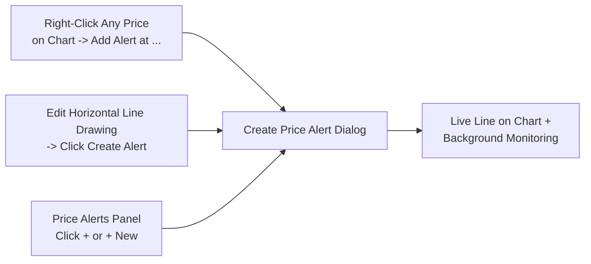

# Price & Indicator Alerts & Notifications

Never miss a breakout, pullback, indicator crossover, or key support/resistance level. **PtView Alerts** monitors real-time prices across your **enabled cryptocurrency exchanges** — rendering price alert lines directly on your charts and notifying you via **Toast popups**, **Alert Sounds**, and **Telegram**.

:::tip Runs Locally Even When Tabs Are Closed
All alerts run locally on your desktop workstation using public live market feeds (only your optional Telegram alert bot uses a locally stored Bot token). Once an alert is active, PTView keeps monitoring that pair and timeframe in the background even if you close its chart tab, and saves your alerts automatically between sessions.
:::

---

## 1. Three Fast Ways to Create a Price Alert

1. **Right-Click Directly on Any Chart** *(Fastest)*:
   - Right-click the exact price level you want to watch and select **Add Alert at ...**.
   - PTView pre-fills the symbol, exchange, target price, and automatically suggests **Crossing Up** (above market price) or **Crossing Down** (below market price).
2. **From a Horizontal Line Drawing**:
   - Draw a **Horizontal Line** on your chart, customize its color, double-click (or click Edit on its floating bar), and click **Create Alert**.
   - Your new alert automatically inherits both the **exact price** and **custom line color** of that horizontal line.
3. **From the Price Alerts Panel**:
   - Click the **Bell** icon on the top-right toolbar (or open **View → Price Alerts**, or click the **Alerts** badge on the bottom status bar), then click **`+`** in the panel header or **`+ New`**.

---

## 2. Alert Conditions, Colors & On-Chart Labels

Inside the **Create / Edit Price Alert** window (scrollable on smaller screens), you can fine-tune every detail:

### Trigger Conditions
| Condition | Symbol | Triggers When |
|---|---|---|
| **Crossing (Any Direction)** | `×` | Price moves across your target level from either above or below |
| **Crossing Up** | `↗` | Price crosses from below up to or above your target level |
| **Crossing Down** | `↘` | Price crosses from above down to or below your target level |
| **Greater Than or Equal** | `≥` | Price is at or rises above your target level |
| **Less Than or Equal** | `≤` | Price is at or drops below your target level |

### Quick Price, Frequency & Visual Options
- **Quick Price Buttons (`-5%`, `-1%`, `Current`, `+1%`, `+5%`)**: Adjust your target price relative to the current market price in one click while seeing the live `% vs current` difference.
- **Trigger Frequency**:
  - **Only Once**: Fires once, moves cleanly to **Triggered**, and records an entry in **History**.
  - **Every Time (Repeating)**: Fires repeatedly whenever the condition matches after waiting at least the configured **Cooldown (sec)** (`5` – `86,400` seconds).
- **Expiration**: Choose **Never**, **1 Hour**, **24 Hours**, **7 Days**, or **30 Days**.
- **Line Color & Alert Name**: Pick any custom **Line Color** alongside your **Alert Name** and **Note / Message**.
  - Active alerts draw a colored dashed line across the chart, a matching price tag on the right Y-axis, and a compact label pill formatted as **`🔔 ↗ +2.50% · Breakout`** showing the live percentage distance directly before your alert name.
  - **Drag to Adjust Target Price on Chart**: Move your mouse over any visible alert line or its `🔔` pill on the chart — the cursor switches to a vertical resize arrow (`↕`) and the line subtly highlights. Press, drag up/down to preview the new level, `%` distance, and ghost marker of your original price live (respecting **Magnet** mode when enabled), and release to save immediately across all open charts and your **Price Alerts** panel (press <kbd>Esc</kbd> or right-click while dragging to cancel).
  - All alert lines, pills, and axis tags adapt automatically for crisp contrast across all 4 workstation themes (**Dark**, **Midnight**, **CyberNavy**, and **Light**).

---

## 3. Managing Alerts & Trigger History in the Right Panel

Click the **Bell** icon on the top-right toolbar (or **View → Price Alerts**) to open the **Price Alerts** drawer:

- **Header Quick Bar**:
  - Click **`+`** to create a new alert for your active chart.
  - Click the **`🕒 <count>`** pill to toggle between your **Alerts** list and triggered **History**.
  - Click **`⋮`** (*More options*) to open the compact drawer menu:
    - **Show All Alert Lines** / **Hide All Alert Lines**: Show or hide all alert lines across open charts in one click without pausing background monitoring.
    - **Highlight Selected Line**: Quick shortcut to turn on/off chart line highlighting for whichever alert is currently selected.
    - **Compact View Mode**: Switch the alert and history lists between compact 2-line rows (fits ~3× more alerts on screen) and detailed cards (default) without losing hover tooltips or quick actions.
    - **Clear Completed Alerts** / **Clear History**: Remove finished (`Triggered` / `Expired`) rules or clear past trigger logs cleanly without taking up bottom bar space.
- **Instant Search & Filter Pills**:
  - Type in **Filter symbol or note...** (click `×` to clear).
  - Filter with one click by **All**, **Active**, **Paused**, **Triggered**, **Indicator**, or **Symbol** (matches only the coin currently open on your active chart).
- **Per-Card Controls & Quick Channel Toggles**:
  - **Select & Highlight Card**: Click any alert or history card to highlight its border in your active **Accent color** so you always know which rule you are inspecting (click empty space or press <kbd>Esc</kbd> to clear).
  - **Jump to Chart**: Click the symbol title on any alert card — or click **Open Chart** on a Toast notification — to switch straight to that exchange, market type, and pair (plus automatically matching the alert's timeframe for Indicator Alerts).
  - **Quick Channel Checkboxes (`Toast` / `Sound` / `TG`)**: Turn Toast popups, Alert Sound, or Telegram delivery on/off individually per alert right from the list card without opening Edit.
  - **Lifecycle & Line Visibility Actions**: For Price Target alerts, click the **Eye** icon to **Show / Hide Alert Line** on your chart independently (background evaluation and Toast/Sound/Telegram notifications keep running normally while hidden — dimmed dot indicates a hidden line). You can also **Pause / Resume** active alerts, **Re-arm** a Triggered or Expired alert back to Active, **Edit** (pencil icon), or **Delete** (trash icon).

---

## 4. Technical Indicator Alerts *(Pro Edition)*

Available in **PTView Pro** (and during your **28-day free Pro Trial**), **Indicator Alerts** monitor over **40 built-in technical indicators** as well as custom **PTView.SDK** plugins automatically across any exchange, symbol, and timeframe (`1m` – `1w`) — even while the chart tab is closed.

### How to Create an Indicator Alert
1. **1-Click Directly from Any Chart Indicator** *(Fastest)*:
   - Hover over an overlay indicator name (e.g., `EMA(20)`, `Bollinger Bands`, `SuperTrend`) or a sub-pane header (`RSI(14)`, `MACD(12,26,9)`), then click the **Amber Bell (`🔔`)** icon.
   - PTView opens the alert dialog with your active exchange, symbol, timeframe, indicator, plot, and current parameter values already filled in.
2. **From the Create Alert Dialog**:
   - Click **`+`** in the **Price Alerts** panel and switch the top mode selector from **Price Target** to **Indicator `PRO`**.

### Three Comparison Modes
| Mode | Examples | When to Use |
|---|---|---|
| **Indicator vs Value** | `RSI(14) ↗ 70`, `CCI(20) ↘ -100`, `MACD Histogram ≥ 0` | Overbought/oversold thresholds or zero-line crosses (supports positive, negative, and zero values, plus 1-click guide-level chips like `30` / `50` / `70`). |
| **Price vs Indicator** | `Close ↗ EMA(200)`, `Close ↘ BB Upper`, `Close × SuperTrend` | Trend breakouts or pullbacks when candle `Close`, `High`, `Low`, or `Open` touches or crosses an overlay indicator. |
| **Indicator vs Indicator** | `MACD ↗ Signal`, `Stoch %K ↘ %D`, `EMA(20) ↗ EMA(50)` | Golden/death crosses or momentum crossovers between two lines of the same indicator or two separate indicators with independent parameters. |

### Evaluation Timing: On Bar Close vs. Real-Time (Intrabar)
- **On Bar Close** *(Recommended Default)*: Evaluates your condition **only when each candle on the chosen timeframe officially closes**, filtering out temporary intrabar wicks and false breakouts while conserving CPU and battery.
- **Real-Time (Intrabar)**: Checks live forming candle updates continuously and honors your configured **Cooldown (sec)** when set to **Every Time (Repeating)**.

:::info Smart Shared Monitoring & Edition Downgrade Protection
- **Shared Streams & Zero Clutter**: Creating multiple Indicator Alerts on the same pair and timeframe automatically reuses existing live market feeds without slowing down your workstation, and shows a live value preview (`Now: ...`) in the **Price Alerts** drawer whenever the panel is open.
- **Safe Pause on Trial Expiry**: If your 28-day Pro Trial or Pro license ends and switches to Community Edition, your Indicator Alerts are **automatically paused (with a `PRO` badge) — never deleted**. As soon as you activate Pro again, they resume automatically.
:::

---

## 5. Notification Defaults & Telegram Forwarding

Press <kbd>Ctrl</kbd> + <kbd>P</kbd> (or go to **Tools → Options**) and select **Notifications → Price Target Alerts** to set your defaults:

| Setting | What It Controls |
|---|---|
| **Show Price Alert Toast Notifications** | Displays an in-app toast when PTView is active, or a Windows desktop toast (with an **Open Chart** button) while minimized or working in another app. |
| **Play Price Alert Sound** | Plays the **Alert** audio cue when a price alert fires (adjust volume, mute when focused, or pick a custom `.wav` / `.mp3` sound under **Settings → Sound → Alert**). |
| **Forward Price Alerts to Telegram** | Sends triggered alerts to your Telegram bot automatically. |
| **Telegram Bot for Price Alerts** | Choose 1 dedicated Telegram bot specifically for Price Alerts when you have 2 or more bots enabled (or follow your global default bot). |
| **Default Repeating Cooldown (seconds)** | Pre-fills the default cooldown (`5` – `86,400s`) for new repeating alerts. |
| **Highlight selected alert line on chart** | Brightens the matching alert line, tag pill, and axis price badge on the chart while subtly dimming sibling lines when an alert item is selected (**default: Off**). |
| **Alert item view mode** | Choose **Details (Default)** for full cards with inline `Toast` / `Sound` / `TG` checkboxes and notes, or **Compact** for slim 2-line rows with all details shown on hover tooltip. |

:::info How Telegram Channel Locking & Bot Selection Works
- **No Telegram Bot Configured or Enabled Yet**: To prevent silent missed alerts, all Telegram toggles and **Telegram / TG** checkboxes across Settings, Create/Edit Alert dialogs, and alert cards stay unchecked and locked automatically. Follow **[Telegram Bot Alerts Setup](telegram-bot-setup.md)** to add and enable your first bot — PTView unlocks Telegram options immediately afterward.
- **1 Enabled Bot**: PTView treats that bot as your automatic default without requiring extra selection.
- **2 or More Enabled Bots**: A **Telegram Bot for Price Alerts** selector appears under **Settings → Notifications → Price Target Alerts** so you can dedicate one bot strictly to price alerts or follow your **Global Default** bot.
:::

---

## 6. Creating & Managing Alerts with AI Copilot & MCP

You can also inspect, create, adjust, or clean up both Price Target Alerts *(Community & Pro)* and Technical Indicator Alerts *(Pro)* in natural language inside **[AI Copilot](ai-copilot.md)** or from any connected **[MCP Server](mcp-server-and-tools.md)** client:

- **Create from price, percentage, or technical indicators**: Ask *"Alert me when BTCUSDT rises 2.5% from the current price"*, *"Alert me on 15m bar close when RSI(14) crosses above 70"*, or *"Send a Telegram alert when BTC 4h MACD crosses above Signal"* — AI Copilot uses `alerts_create` and fills in your active chart's exchange, symbol, and timeframe automatically when omitted.
- **Review & edit existing rules**: Ask *"List all active price alerts"* (`alerts_list`), *"Show triggered alert history for ETH"* (`alerts_get_history`), *"Move my BTC alert target to 105,000, hide its line on chart, or pause it"* (`alerts_modify`, `alerts_set_status`), or *"Clear completed price alerts"* (`alerts_clear`).
- **One-click `⚡` Quick Ask presets**: Open **`⚡` Quick Ask** in AI Copilot and select the **Alerts** category chip for ready-to-use templates — *Auto S/R Price Alerts*, *Set % Breakout & Breakdown Alerts*, and *Audit Active Alerts & Trigger History*.
- **Safe `/schedule` checks**: Scheduled `/schedule` prompts can read `alerts_list` and `alerts_get_history` to summarize your alert status alongside market data, while alert creation, modification, and deletion stay restricted to interactive chat and manual confirmation.

