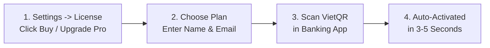

# Upgrading to PTView Pro & Payment Guide

:::warning Pro Upgrades Temporarily Paused
Pro Edition features, 28-day Pro trials, and new Pro purchases are currently **temporarily paused and locked in the app** while PtView awaits exchange market-data licensing approval. **Community Edition** remains free to use.
:::

When Pro licensing is active, new installations of PtView Workstation include a **28-day free Pro Trial**, and you can upgrade to **PTView Pro** in less than a minute via **VietQR**.

---

## Available Pro Plans

Live pricing is fetched directly inside the app and on the web checkout page:

| Plan | Duration | Best For |
|---|---|---|
| **PTView Pro 1 Month** | 30 days | Short-term evaluation or monthly trading sprints |
| **PTView Pro 1 Year** *(Recommended)* | 365 days | Active traders saving **45%** compared to monthly billing |

:::note Auto-Renewal, Trial & Exchange Terms
- Neither the **28-day Trial** nor **1 Month / 1 Year** plans auto-renew or apply recurring charges.
- For the **1 Year** plan, **features and supported exchanges may change in accordance with each exchange's API and data terms**.
:::

---

## Method 1: Upgrade Directly Inside the App (Recommended)

You do not need to leave PtView Workstation to pay or activate your license.

1. Open **Settings** (<kbd>Ctrl</kbd> + <kbd>P</kbd>) and select **License** in the left sidebar (or click the edition badge in the bottom-right status bar).
2. Click **Buy / Upgrade Pro** in the **Upgrade to PTView Pro** banner.
3. **Select your plan** (1 Month or 1 Year).
4. Fill in your details:
   - **License Holder Name**: The name shown on your license certificate.
   - **Email to Receive License**: Used to receive a backup copy of your license key and to restore your license anytime if you reinstall Windows.
   - **Bind license to this workstation**: Keep checked to lock the license to your current PC, or **uncheck** if you want to use the license flexibly across multiple computers.
5. Click **Generate VietQR Code**.
6. Open any Vietnamese banking app (Vietcombank, VietinBank, MB, Techcombank, BIDV, TPBank, Momo, etc.) and scan the **VietQR** code:
   - Click the QR image (or **Enlarge QR**) to open a full-screen resizable preview for easier phone scanning.
   - Click **Save QR PNG** if you want to save the QR image and upload it into your banking app from your gallery.
   - If transferring manually, enter the **exact Transfer Memo** (e.g., `PTV8921`) and **exact Amount** shown on screen.
7. Keep the dialog open — PtView checks your payment automatically every **3 seconds** and unlocks **PTView Pro** immediately once your transfer arrives (typically 3–5 seconds).

:::tip Backup License Key
Once activated, copy and save your **License Key** (`PTV1-...`) or check your email inbox for a backup copy. You can also restore your Pro license anytime using just your **Email** or **Order Code**.
:::

---

## Method 2: Pay via Browser Web Checkout

If you prefer paying from a browser or purchasing for another computer:

1. Click **Open Web Checkout** in the top-right corner of the **Upgrade to PTView Pro** dialog (or visit the [PTView Pro Checkout Page](https://pay.ptview.app/)).
2. When opened from the desktop app, your **Name**, **Email**, and **Machine ID** are pre-filled automatically.
3. Choose your plan, click **Generate VietQR**, and scan the QR code to complete payment.
4. Once payment succeeds on the webpage, return to PtView Desktop and use **Restore & Auto-Activate** (below).

---

## Method 3: Restore a Paid License or Activate Offline

Already paid previously, reinstalled Windows, or moved to a new PC?

### Option A — 1-Click Online Restore
1. Open **Settings → License**.
2. Under **Restore Paid License**, enter the **Email** you used when purchasing or your **Order Code** (e.g., `PTV8921`).
3. Click **Restore & Auto-Activate** — PtView retrieves your signed license and activates Pro immediately.

:::warning Paid Before Clicking "Restore & Auto-Activate"?
The **Restore & Auto-Activate** button only looks up **completed & paid** orders. If you haven't purchased a license yet, click **Buy / Upgrade Pro** first instead of entering your email in the restore box.
:::

### Option B — Offline License Key Activation
1. Open **Settings → License**.
2. Enter your **Licensed To** name and paste your `PTV1-...` **License Key** (from your confirmation email or checkout screen).
3. Click **Activate Pro Edition**. Offline activation works with zero internet connection.

---

## Payment Troubleshooting

- **I transferred the money, but Pro hasn't unlocked after 1 minute:**
  - Click **I Have Paid • Check Now** in the payment dialog.
  - Verify that your bank transfer included the **exact Order Code** (`PTV...`) in the transfer memo and the **exact VND amount** (underpaid transfers cannot be auto-activated).
- **Didn't receive the confirmation email?**
  - Check your **Spam / Promotions** folder first.
  - Even without the email, your license is safely stored against your purchase **Email** and **Order Code** — use **Restore Paid License** in **Settings → License** to activate right away.
- **Machine ID mismatch error when restoring on a second PC:**
  - If you checked *Bind license to this workstation* during purchase, that license is locked to the original PC's Machine ID. Uncheck that option during checkout if you plan to switch machines.

