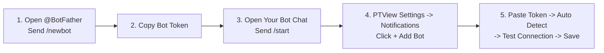

# Creating & Connecting a Telegram Bot

Connect your own Telegram bot to PTView in 2 minutes to receive AI Copilot market summaries, `/schedule` monitoring alerts, and price notifications straight on your phone or Telegram group.



---

## Step 1: Create a Bot via `@BotFather` on Telegram

1. Open Telegram (Desktop or Mobile) and search for **`@BotFather`** (look for the official blue verified checkmark).
2. Tap **Start** and send the command:
   ```text
   /newbot
   ```
3. **Enter a display name** for your bot (e.g., `PTView Trade Alerts`).
4. **Enter a unique username** ending in `bot` (e.g., `my_ptview_alerts_bot`).
5. `@BotFather` replies with your **HTTP API Token** looking like:
   ```text
   1234567890:AAHxxxxxxxxxxxxxxxxxxxxxxxxxxxxxxx
   ```
   Copy this token carefully.

---

## Step 2: Activate Your Bot Chat (Crucial!)

:::info Why `/start` Is Required
Telegram blocks any new bot from messaging you until **you** start the conversation first.
:::

- **For personal alerts (DM)**: Click the `t.me/<your_bot_username>` link in `@BotFather`'s message and tap **Start** (or send `/start`).
- **For Telegram Group alerts**: Add your new bot to the target group and send any message (e.g., `/start` or `hello`) inside that group.

---

## Step 3: Add the Bot in PTView (`Settings → Notifications`)

1. Open **Settings** (<kbd>Ctrl</kbd> + <kbd>P</kbd>) and select **Notifications** in the left sidebar.


2. Click **+ Add Bot** to open the **Add Telegram Bot** dialog.


3. Paste your **Bot Token** into the **Bot Token** field.
4. Click **Auto Detect** next to **Chat ID**:
   - PTView queries Telegram's latest update, automatically fills the **Alias** and **Chat ID**, and sends a verification message directly to your Telegram chat!
5. *(Optional)* Click **Test Connection** anytime to verify delivery (automatically routed through your HTTP/SOCKS5 Proxy if enabled under **Settings → Network**).
6. Check **Enabled** (and **Set as Default** if you want this bot used automatically), then click **Save**.

---

## Step 4: Test & Automate Alerts in AI Copilot

Open **AI Copilot** (<kbd>Ctrl</kbd> + <kbd>J</kbd>) and try:
- Check Telegram status: `/notify status`
- Turn on notifications for current session: `/notify on`
- Switch between multiple bots: `/notify bot <alias>`
- Schedule recurring Telegram alerts:
  ```text
  /schedule every 15m check RSI(14) and funding rate on BTCUSDT --notify
  ```

:::tip Troubleshooting Auto Detect
If **Auto Detect** says no recent chat was found:
1. Open your bot's chat in Telegram and send `/start` again.
2. Click **Auto Detect** immediately within a few seconds.
3. If Telegram is blocked on your network, enable your proxy first under **Settings → Network**.
:::

