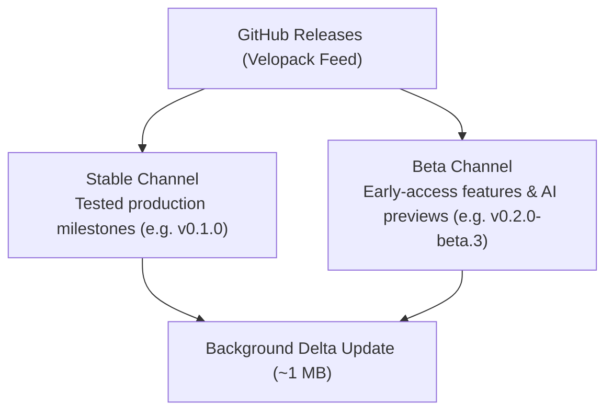

# Editions, Installation & Update Channels

PtView Workstation ships as a single unified Windows package with automatic delta updates powered by **Velopack**.

---

## Editions: Community vs. Pro

:::warning Pro Features & Sales Temporarily Paused
To support exchange commercial market-data licensing applications (`OKX`, `Binance`, `Bybit`), **Pro Edition features, 28-day Pro trials, and paid Pro upgrades are currently temporarily locked** via app control flag. All users can download and run **Community Edition** completely free.
:::

You never need to uninstall or download a different build to switch editions. When Pro sales are active, you can upgrade directly inside the app via VietQR or enter a Pro license key under **Settings → License** — see the [Upgrading to Pro & Payment Guide](./app/pro-upgrade-and-payment.md) for step-by-step instructions.

### 28-Day Complimentary Pro Trial
Every new installation automatically begins with **28 days of full Pro access** — no sign-up or credit card required. After 28 days, PTView smoothly switches to the **Community Edition** (free forever) while keeping all your workspaces, settings, indicators, and drawings intact.

| Feature / Capability | Community Edition (Free) | Pro Edition (or 28-Day Trial) |
|---|---|---|
| **Multi-Exchange Real-Time Feeds** | OKX, Binance & Bybit (Spot, Perpetual & Futures) | OKX, Binance & Bybit (Spot, Perpetual & Futures) |
| **Workspace Tabs** | Up to **3 tabs** | **Unlimited** workspace tabs |
| **Concurrent Charts per Tab** | Up to **2 charts** (Single / Split) | Up to **4 charts** (`2×2`, `1+2`, `1+3` grid layouts) |
| **Indicators per Chart** | Up to **5 active indicators** (`X/5` badge) | **Unlimited** active indicators |
| **Custom C# SDK Plugins (`PTView.SDK`)** | Built-in indicators only | **Full external plugin hosting** (isolated worker) |
| **AI Copilot & ReAct Automation** | Standard single-account AI analysis | **Full ReAct Copilot** + **Multi-Account Failover** |
| **External MCP Integration** | Standard MCP access | **Unrestricted MCP tool execution** |
| **Historical Candle Memory Buffer** | Up to 2,000 bars per timeframe | Up to **50,000+ bars** with disk caching |
| **License Activation** | Free forever (no key required) | **Offline ECDSA P-256 license key** |

---

## Installation Options

### 1. Windows Installer (`PTViewWorkstation-win-Setup.exe`) — Recommended
- Installs into your user profile (`%LocalAppData%\PTViewWorkstation`) with **no Administrator rights required**.
- Creates Desktop and Start Menu shortcuts.
- Enables automatic background delta updates (`~1 MB` patches applied in seconds on restart).
- Keeps your user data separate under `%LocalAppData%\PTView` so updates never overwrite workspaces.

### 2. Portable Archive (`PTViewWorkstation-win-Portable.zip`)
- Self-contained archive for USB drives or locked-down corporate PCs.
- Extract to any folder and run **`PTView.Desktop.exe`**.
- Stores settings, cache, and workspaces inside `<ExtractedFolder>\data\`.

---

## Update Channels: Stable vs. Beta

- **Stable Channel**: Thoroughly tested production releases recommended for daily live analysis.
- **Beta Channel**: Early-access releases with the latest features, AI Copilot upgrades, and UI refinements.

### Switching Update Channels
1. Open **Settings** (<kbd>Ctrl</kbd> + <kbd>P</kbd>).
2. Select **Updates** in the left sidebar.
3. Choose **Stable** or **Beta** under **Update Channel**, then click **Check for Updates Now**.

:::tip Safe Channel Switching
When switching from **Beta** back to **Stable**, keep **Allow channel downgrade** enabled in **Settings → Updates** so Velopack can install the latest Stable build cleanly without touching your data.
:::
