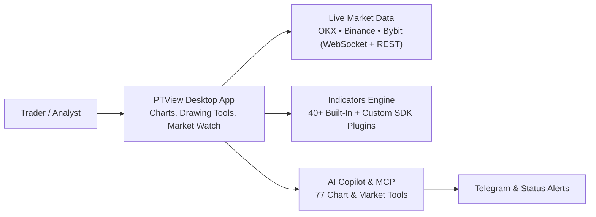

# Welcome to PtView Workstation

**PTView** is a fast, modern Windows desktop crypto charting workstation built for traders who want native desktop speed, multi-exchange market coverage, and built-in AI chart analysis — without browser lag or monthly chart limits.

:::tip New to PTView?
Jump straight to the **[5-Minute Quick Start Guide](quickstart.md)** to install PTView, open your first live chart, add indicators, and connect AI Copilot in just a few clicks.
:::

---

## What You Can Do with PTView

### 1. Smooth 60 FPS Native Charts (Zero Browser Lag)
- Built as a native Windows desktop application (`.NET 10` WPF) — no embedded browser tabs, no heavy memory bloat.
- Organize your trading with **Multi-Tab Workspaces** and **up to 4 charts per tab** (`1`, `2 Split`, `3 Charts`, or `2×2` grid), with **1-click Symbol Sync**, **2D Crosshair Sync** across timeframes, and branded 4K screenshots via <kbd>Ctrl</kbd> + <kbd>Shift</kbd> + <kbd>S</kbd>.

### 2. Live Market Data Across 3 Core Crypto Exchanges
- Stream real-time candlesticks, tickers, and order books across **`OKX`**, **`Binance`**, and **`Bybit`** (Spot, Perpetual, and Delivery contracts).
- **No exchange API key required** to watch charts or analyze markets.

### 3. Built-In AI Copilot & Automated Monitoring (`/schedule`)
- Open **AI Copilot** (<kbd>Ctrl</kbd> + <kbd>J</kbd>) and ask questions in plain language or attach indicators and drawings automatically.
- Use `/schedule` to run recurring market checks in the background and receive Telegram alerts when conditions trigger.
- Connect external AI tools (**VS Code Copilot**, **Cursor**, **Claude Desktop**, **Antigravity**) over the built-in **MCP Server** (`77 tools`).

### 4. Custom Indicators via `PTView.SDK`
- Comes with **40+ built-in indicators** (EMA, SMA, SuperTrend, Bollinger Bands, Ichimoku Cloud, RSI, MACD, VWAP, and more).
- Developers can write custom C# indicators using the zero-dependency `PTView.SDK` running safely out-of-process.

---

## How PTView Fits Together

---

## Choose Your Path

| I want to... | Start Here |
|---|---|
| **Install & start charting in 5 minutes** | [5-Minute Quick Start](quickstart.md) |
| **Compare Community (Free) vs. Pro (28-Day Trial)** | [Editions & Release Channels](editions-and-channels.md) |
| **Master layout, Market Watch, Navigator & Zoom** | [Workstation UI Guide](app/workstation-ui.md) |
| **Set up Gemini / OpenAI / Ollama API keys** | [AI API Keys & Accounts Setup](app/ai-api-keys-setup.md) |
| **Create & connect a Telegram alert bot** | [Telegram Bot Alerts Setup](app/telegram-bot-setup.md) |
| **Use AI Copilot chat & `/schedule`** | [AI Copilot & Chat Commands](app/ai-copilot.md) |
| **Fix network/proxy issues or export logs** | [Troubleshooting & FAQ](app/troubleshooting-and-faq.md) |
| **Build custom C# indicators** | [PTView.SDK Getting Started](sdk/getting-started.md) |
