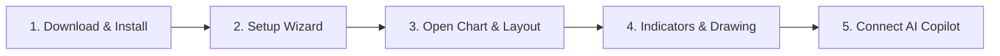

# 5-Minute Quick Start Guide

New to **PtView Workstation**? Follow these 5 simple steps to install the app, open your first live crypto chart, attach indicators, and run your first AI analysis.

---

## Step 1: Download & Install (Windows)

1. Go to **[PTView Releases](https://github.com/vntradesoft/ptview-releases/releases)** and download:
   - **`PTViewWorkstation-win-Setup.exe`** *(Recommended)* — 1-click installer with automatic background updates and Start Menu shortcut.
   - **`PTViewWorkstation-win-Portable.zip`** — Extract anywhere and launch `PTView.Desktop.exe` directly (great for USB or restricted PCs).
2. Double-click the installer. No Administrator privileges are required.

:::tip Windows SmartScreen Notice
If Windows displays **"Windows protected your PC"** on a new Beta build, click **More info** → **Run anyway**. Checksums for every release file are published in `checksums-sha256.txt` on the release page.
:::

---

## Step 2: Complete the First-Launch Setup Wizard

On first launch, the **Workstation Setup Wizard** walks you through 4 quick screens:
1. **Welcome & Appearance**: Choose your language (**English** or **Tiếng Việt**), visual theme (**Dark**, **Midnight OLED**, **CyberNavy**, or **Light**), and accent color.
2. **License & Risk Policy**: Review and check both acknowledgments (Software License & Trading Risk Disclaimer).
3. **Exchanges & Defaults**: `OKX`, `Binance`, and `Bybit` are all ready out of the box — keep all three active or toggle the ones you trade on.
4. **Summary & Finish**: Click **Finish** to launch the workstation with an automatic **28-day complimentary Pro trial**.

---

## Step 3: Pick a Coin, Timeframe & Chart Layout

1. **Switch Exchange**: Use the exchange dropdown on the top-left toolbar (or filter inside **Market Watch** `Ctrl+M`).
2. **Search Any Pair (`Ctrl+K`)**: Press `Ctrl+K` (or click the pair badge on the toolbar), type e.g. `BTC`, `ETH`, `SOL`, and choose **Spot** or **Perp**.
3. **Change Timeframe**: Click `1m`, `5m`, `15m`, `30m`, `1h`, `4h`, `1d` on the toolbar — or click the dropdown arrow to customize your favorite pinned intervals.
4. **Multi-Chart View**: Click the layout pills on the toolbar to switch between **1 Chart**, **2 Split**, **3 Charts**, or **2×2 Grid** (available in Pro / 28-day Trial).

---

## Step 4: Add Indicators & Draw Levels

- **Add an Indicator (`Ctrl+I`)**: Press `Ctrl+I`, search for `EMA`, `RSI`, `MACD`, or `Bollinger`, and press `Enter`. Or browse by category in the **Navigator** panel (`Ctrl+Shift+N`).
- **Draw Support / Resistance / Trendlines**: Pick a tool on the **left Drawing Toolbar** (Trend Line, Horizontal Line, Rectangle Zone, Fibonacci Retracement). Turn on **Magnet Mode** to snap cleanly to candle highs/lows.
- **Zoom & Navigate**: Scroll the mouse wheel to zoom, drag the price or time axis to stretch, or hold `Alt+Drag` to **Box Zoom** into any region (`Ctrl+0` resets auto-fit).

---

## Step 5: Optional — Enable AI Copilot (`Ctrl+J`)

1. Open **Tools → AI Settings** and click **Add** under **AI Accounts** (see **[AI API Keys & Accounts Setup](app/ai-api-keys-setup.md)** for Gemini Free, OpenAI, DeepSeek, or local Ollama step-by-step instructions).
2. *(Optional)* Connect a Telegram alert bot in 2 minutes: **[Telegram Bot Alerts Setup](app/telegram-bot-setup.md)**.
3. Press `Ctrl+J` to open **AI Copilot** on the right panel and ask in plain language:
   - *"Summarize the current 1h trend and mark key support/resistance zones."*
   - *"`/schedule` every 15m check RSI and funding rate --notify"*

:::info Read-Only Safety
AI Copilot only reads market data and draws/annotates charts — **it never places orders or accesses exchange trading funds**. You do **not** need any exchange API key just to view charts or use AI analysis.
:::

