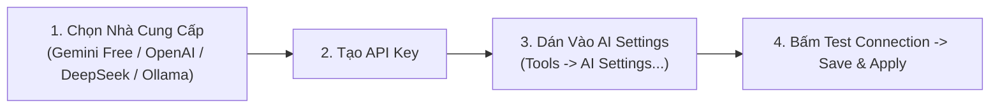

# Hướng Dẫn Tạo & Gắn Tài Khoản API Key AI

PTView AI Copilot hoạt động theo cơ chế **Bring Your Own Key (BYOK)** — bạn tự gắn API key cá nhân từ Google Gemini, OpenAI, DeepSeek, OpenRouter, hoặc chạy **Ollama** miễn phí 100% ngay trên máy tính. Mọi API key chỉ được **lưu cục bộ trên máy bạn**, không gửi lên máy chủ của PTView.




---

## Cách 1: Google Gemini (Có Gói Miễn Phí — Khuyên Dùng)

Google cấp sẵn hạn mức miễn phí cho model `gemini-2.5-flash`, tốc độ nhanh và gọi công cụ vẽ/chỉ báo rất chuẩn.

1. Mở **[Google AI Studio](https://aistudio.google.com/apikey)** và đăng nhập bằng tài khoản Google (Gmail).
2. Bấm **Create API key** (chọn tạo key trong Google Cloud project mới hoặc có sẵn).
3. Copy chuỗi key vừa tạo (bắt đầu bằng `AIza...`).
4. Mở PTView → **Tools → AI Settings…** → tab **AI Accounts**.
5. Bấm **Add** để tạo tài khoản đầu tiên (hoặc bấm **Cấu hình tài khoản AI** ngay trên màn hình chào của AI Copilot) và điền:
   - **AI Provider**: `Google Gemini (Official / Recommended)`
   - **API Key / Auth Token**: Dán chuỗi `AIza...`
   - **Model ID**: `gemini-2.5-flash` (hoặc bấm **Fetch Models** để tải danh sách model mới nhất)
6. Bấm **Test Connection** → thấy báo thành công màu xanh → bấm **Save & Apply**.

---

## Cách 2: OpenAI (ChatGPT API)

1. Truy cập **[OpenAI API Keys](https://platform.openai.com/api-keys)** và đăng nhập.
2. Nạp số dư tín dụng tại **Settings → Billing** (lưu ý: gói ChatGPT Plus $20/tháng trên web tách riêng với API Platform).
3. Bấm **+ Create new secret key**, đặt tên `PTView` và copy key `sk-...`.
4. Trong PTView **Tools → AI Settings…**:
   - **AI Provider**: `OpenAI / OpenAI-Compatible`
   - **API Key / Auth Token**: Dán chuỗi `sk-...`
   - **Model ID**: `gpt-4.1-mini` hoặc `gpt-4o` (hoặc bấm **Fetch Models**)
5. Bấm **Test Connection** → **Save & Apply**.

---

## Cách 3: DeepSeek

1. Đăng nhập **[DeepSeek Platform](https://platform.deepseek.com/api_keys)** và nạp tín dụng API.
2. Bấm **Create new API key** và copy key vừa tạo.
3. Trong PTView **Tools → AI Settings…**:
   - **AI Provider**: `DeepSeek`
   - **API Key / Auth Token**: Dán API key
   - **Model ID**: `deepseek-chat` (hoặc `deepseek-reasoner`)
4. Bấm **Test Connection** → **Save & Apply**.

---

## Cách 4: OpenRouter (1 Key Dùng 100+ Model Miễn Phí & Trả Phí)

1. Đăng nhập **[OpenRouter Keys](https://openrouter.ai/keys)** và bấm **Create Key**.
2. Trong PTView **Tools → AI Settings…**:
   - **AI Provider**: `OpenRouter`
   - **API Key / Auth Token**: Dán chuỗi `sk-or-...`
   - Bấm **Fetch Models** để chọn các model miễn phí (đuôi `:free`) hoặc trả phí (Claude, GPT, Gemini, Llama).
3. Bấm **Test Connection** → **Save & Apply**.

---

## Cách 5: Ollama (Miễn Phí & Chạy Offline 100% Trên Máy)

Phù hợp nếu bạn có GPU rời và muốn AI chạy hoàn toàn nội bộ không tốn phí API:

1. Tải và cài đặt **[Ollama](https://ollama.com/download)** cho Windows.
2. Mở PowerShell hoặc Command Prompt và tải model hỗ trợ tool-calling:
   ```powershell
   ollama pull qwen2.5:7b
   ```
3. Đảm bảo Ollama đang chạy dưới khay hệ thống (hoặc chạy `ollama serve`).
4. Trong PTView **Tools → AI Settings…**:
   - **AI Provider**: `Ollama (Local)`
   - **API Key / Auth Token**: Để trống (hoặc nhập `ollama`)
   - **Custom API Base URL**: `http://localhost:11434/v1`
   - Bấm **Fetch Models** và chọn `qwen2.5:7b`
5. Bấm **Test Connection** → **Save & Apply**.

---

## Gắn Nhiều Key Dự Phòng (Tự Động Chuyển Khi Gặp Rate Limit)

Nếu dùng gói miễn phí bị giới hạn lượt gọi/phút, bạn nên thêm 1–2 tài khoản dự phòng:
1. Ở tab **AI Accounts**, bấm **Add** (hoặc **Duplicate**) để thêm key Gemini phụ hoặc nhà cung cấp khác (OpenRouter / DeepSeek).
2. Chuyển sang tab **Common & Failover** và bật **Auto-switch account on quota/network failure**.
3. Khi tài khoản chính gặp lỗi mạng hoặc chạm giới hạn `429 Rate Limit`, PTView sẽ tự động xoay vòng sang tài khoản dự phòng để câu trả lời không bị gián đoạn.

:::tip Bảo Mật Tuyệt Đối
Toàn bộ API Key chỉ nằm trên máy tính của bạn và được `SecretRedactor` tự động che đi nếu bạn xuất file Diagnostics `.zip` gửi hỗ trợ.
:::

