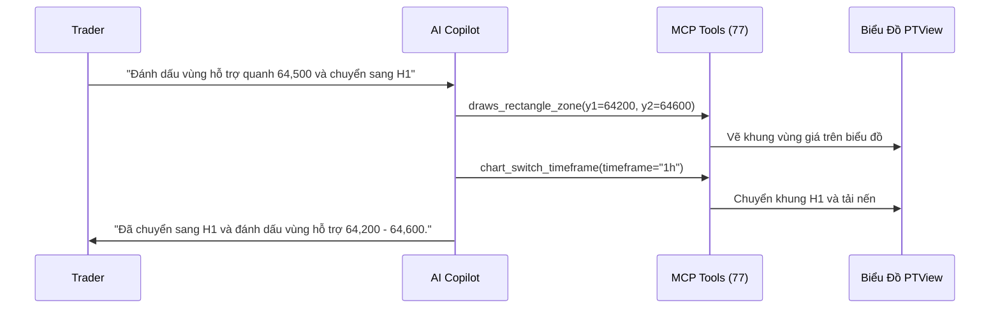

# Trợ Lý AI Copilot & Lệnh Chat Nhanh

PTView tích hợp sẵn **AI Copilot** (<kbd>Ctrl</kbd> + <kbd>J</kbd>) ngay bên cạnh biểu đồ, giúp bạn phân tích cấu trúc giá, gắn chỉ báo, vẽ vùng hỗ trợ/kháng cự và đặt lịch theo dõi thị trường hoàn toàn bằng tiếng Việt hoặc tiếng Anh tự nhiên.

:::note An Toàn Tuyệt Đối (Chỉ Phân Tích)
PTView là công cụ phân tích biểu đồ chuyên sâu. Hệ thống **không bao gồm** công cụ đặt lệnh hay giao dịch tài khoản sàn trong AI Copilot hoặc MCP server.
:::

:::warning Giới Hạn AI & Miễn Trừ Rủi Ro
Mô hình AI có thể phát sinh sai số ("ảo giác") hoặc nhận định sai cấu trúc thị trường. Luôn tự kiểm chứng độc lập trước khi giao dịch — xem chi tiết tại [Miễn Trừ Rủi Ro Giao Dịch & AI Copilot](../legal/risk-and-ai-disclaimer.md).
:::

---

## 1. Cách Gắn API Key AI Lần Đầu (3 Bước Đơn Giản)

PTView theo mô hình **Bring Your Own Key (BYOK)** — bạn có thể dùng gói miễn phí từ Google hoặc chạy AI cục bộ hoàn toàn miễn phí trên máy:

1. Nếu chưa thêm tài khoản nào, khung **AI Copilot** sẽ hiển thị nút **Cấu hình tài khoản AI** để mở nhanh **Tools → AI Settings → AI Accounts**.
2. Bấm **Add Account**, chọn nhà cung cấp và dán API Key của bạn:
   - **Google Gemini (Có gói miễn phí)**: Tạo key miễn phí tại [Google AI Studio](https://aistudio.google.com/apikey), chọn model `gemini-2.5-flash`.
   - **OpenAI / DeepSeek / OpenRouter / Anthropic**: Chọn nhà cung cấp, dán API Key và chọn model.
   - **Ollama (Miễn phí & Offline 100%)**: Chạy `ollama serve` trên máy, điền URL `http://localhost:11434/v1` và chọn model đã tải.
3. Bấm **Test Connection** → **Save**. Bạn có thể thêm nhiều tài khoản để PTView tự động chuyển dự phòng (failover) nếu 1 key hết hạn mức.

:::tip Hướng Dẫn Chi Tiết Từng Bước
- Chưa có API key? Xem **[Đăng Ký & Gắn API Key AI](./ai-api-keys-setup.md)** (chi tiết từng bước từ Google AI Studio, OpenAI, DeepSeek, OpenRouter tới Ollama offline).
- Muốn nhận cảnh báo về điện thoại? Xem **[Tạo & Gắn Bot Telegram](./telegram-bot-setup.md)**.
:::

---

## 2. Luồng Hoạt Động Giữa AI Copilot & Biểu Đồ

---

## 3. Các Tính Năng Tiện Ích Trong Khung Chat

### Nhận Biết Bàn Làm Việc & Khóa Ngữ Cảnh Tự Động
AI tự động bám theo toàn bộ ngữ cảnh tab làm việc và biểu đồ bạn đang mở:
- **Nhận diện Tab & Bố Cục Lưới**: AI biết bạn đang đứng ở tab nào (ví dụ `Tab 1/3: "BTC MTF"`, `Lưới: SplitVertical, 2 biểu đồ`) và có thể đổi trực tiếp cặp giao dịch/sàn (`OKX`, `Binance`, `Bybit`) trên biểu đồ hiện tại, chuyển tab, tạo tab mới hoặc đổi layout theo yêu cầu tự nhiên.
- **Khóa Symbol (Bật)**: Bạn chỉ cần hỏi *"RSI hiện tại bao nhiêu?"* mà không cần gõ lặp lại `BTC/USDT`.
- **Khóa Timeframe (Bật)**: Mặc định phân tích khung giờ đang mở; bỏ tick nếu muốn AI đọc đa khung (`15m`, `1h`, `4h`, `1d`).

### Thanh Công Cụ Khung Chat: Menu `+`, Chọn Model & Thống Kê Token Tháng
Ngay dưới ô nhập chat, bạn có thể thao tác nhanh mà không cần rời khung trò chuyện:
- **Menu Hành Động Nhanh (`+`)**: Mở nhanh danh sách **Lệnh (`/`), Công cụ MCP (`#` — đầy đủ 77 công cụ như `#market_get_candles`, `#indicators_add`, `#draws_horizontal_line`, `#workspace_switch_symbol`, `#workspace_switch_tab`, `#notify_send`), Mẫu Hỏi Nhanh (`⚡ Quick Ask` — tùy biến trong AI Settings → Quick Ask), và Khóa Ngữ Cảnh (Symbol / Timeframe Lock)**.
- **Chọn Nhanh Model (Model Picker)**: Bấm vào tên model ở chân ô nhập để đổi model ngay lập tức (hỗ trợ danh sách gợi ý sẵn lẫn tự động quét model từ API của nhà cung cấp).
- **Thống Kê Token Tháng (Monthly Usage)**: Bấm vào chỉ số token để xem tổng lượng token đã dùng trong tháng và chi tiết theo từng nhà cung cấp.

### Mẫu Hỏi Nhanh (`⚡ Quick Ask`)
Nhấn nút **`⚡`** trên thanh công cụ chat để mở **21 mẫu câu lệnh tích hợp sẵn** — bao phủ từ phân tích kỹ thuật, phái sinh (OI/funding/Long-Short), tự động gắn & quét chỉ báo, vẽ Fibonacci/vùng cung-cầu, đến đọc tin tức nóng và tổng quan workspace:
- **Tìm nhanh**: Lọc theo **Phạm vi** (*Không gian* / *Toàn cục* / *Tất cả*), **Nhóm** (*PTKT & Chart*, *Phái sinh*, *Chỉ báo*, *Vẽ Chart*, *Tin & Dữ liệu*, *Không gian*), hoặc gõ từ khóa / tên `#tool` vào ô tìm kiếm.
- **Tùy biến riêng**: Tạo, sửa hoặc sắp xếp mẫu cá nhân trong **AI Settings → Quick Ask**; hỗ trợ biến `{symbol}` và `{timeframe}` để tự động điền theo biểu đồ đang mở.

### Theo Dõi Tự Động Theo Lịch (`/schedule`)
Hẹn AI tự kiểm tra thị trường định kỳ và gửi thông báo về **Telegram** hoặc thanh trạng thái:
- **Lặp vô hạn**: `/schedule every 15m kiểm tra RSI và các vùng hỗ trợ --notify`
- **Chạy N lần (`--repeat` / `xN`)**: `/schedule every 30m --repeat 3 theo dõi funding rate và OI`
- **Hẹn 1 lần (`in` / `once`)**: `/schedule in 10m kiểm tra đóng nến H4 --notify`
- **Quản lý lịch**: `/schedule list`, `/schedule run 1`, `/schedule pause all`, `/schedule resume all`, `/schedule cancel 1`

:::info An Toàn Khi Chạy Nền
Mọi tác vụ `/schedule` đều chạy ở **chế độ chỉ đọc (read-only)** — AI chỉ đọc giá, funding, chỉ báo và gửi cảnh báo, tuyệt đối không tự ý vẽ thêm hay đổi bố cục biểu đồ của bạn. Tùy chỉnh cấu hình scheduler tại **AI Settings → Common**.
:::

---

## 4. Bảng Tra Cứu Đầy Đủ 21 Lệnh `/`

Gõ `/` trong ô nhập chat để mở bảng gợi ý lệnh nhanh:

### Quản Lý Phiên Chat & Lịch Hẹn
| Lệnh | Viết Tắt | Chức Năng |
|---|---|---|
| `/new` | `/n` | Tạo phiên chat mới |
| `/clear` | `/cls`, `/c` | Xóa sạch tin nhắn trong phiên hiện tại |
| `/resume [id\|title]` | `/open` | Quay lại một phiên chat cũ |
| `/rename <new_title>` | `/title` | Đổi tên phiên chat |
| `/delete` | `/del`, `/rm` | Xóa phiên chat hiện tại |
| `/export [md\|json] [path]` | `/save`, `/dump` | Xuất lịch sử chat ra Markdown hoặc JSON |
| `/compact [instructions]` | `/summarize` | Tóm tắt ngữ cảnh để tiết kiệm token |
| `/schedule [every\|in\|list\|run\|pause\|resume\|cancel]` | `/cron`, `/timer` | Lập lịch, tạm dừng, chạy thử hoặc hủy tác vụ AI chạy nền |

### Điều Khiển Phản Hồi & Thông Báo
| Lệnh | Viết Tắt | Chức Năng |
|---|---|---|
| `/stop` | `/abort`, `/cancel` | Dừng ngay quá trình AI đang trả lời |
| `/retry` | `/r`, `/regen` | Gửi lại yêu cầu vừa rồi |
| `/notify [on\|off\|status\|bot <alias>]` | `/telegram`, `/tg` | Bật/tắt hoặc kiểm tra kênh Telegram Bot |

### Công Cụ & Tự Động Duyệt
| Lệnh | Viết Tắt | Chức Năng |
|---|---|---|
| `/tools [filter]` | `/mcp` | Liệt kê 77 công cụ MCP hoặc lọc theo từ khóa |
| `/autoapprove [on\|off]` | `/approve` | Bật/tắt tự động duyệt các thao tác vẽ/chỉnh biểu đồ |

### Hệ Thống, Tài Khoản & Token
| Lệnh | Viết Tắt | Chức Năng |
|---|---|---|
| `/help [command]` | `/h`, `/?` | Xem hướng dẫn lệnh `/` |
| `/status` | `/info` | Xem tài khoản AI, model, biểu đồ và trạng thái Telegram |
| `/scope` | — | Xem cặp coin & khung giờ đang khóa |
| `/account [ai\|tele [target]]` | `/acc` | Xem hoặc đổi tài khoản AI / Bot Telegram đang dùng |
| `/model [model_id\|reset]` | `/m` | Đổi tạm model cho phiên chat hiện tại |
| `/context` | `/ctx` | Xem mức sử dụng bộ nhớ ngữ cảnh (token) |
| `/usage` | `/tokens`, `/stats` | Thống kê lượng token đã tiêu thụ |
| `/logs [lines]` | `/log` | Xem nhanh log AI & MCP gần nhất |

---

## 5. Ví Dụ Câu Lệnh Mẫu Để Thử Ngay

- *"Thêm đường EMA 20 màu vàng, EMA 50 màu xanh dương và RSI(14) ở bên dưới."*
- *"Tìm đỉnh và đáy rõ nhất trên khung H4 rồi vẽ Fibonacci Retracement giúp mình."*
- *"Chỉ số Fear & Greed hôm nay và Funding Rate BTC trên Binance đang là bao nhiêu?"*
- *"Phân tích nhanh cấu trúc xu hướng khung H1 và gửi tóm tắt về Telegram cho mình."*
- *"Chuyển biểu đồ hiện tại sang OKX BTC-USDT-SWAP rồi xem giá hiện tại giúp mình."*
- *"Chuyển sang tab 2 và đổi layout sang 2 biểu đồ dọc."*
- *"Mở tab mới cho SOL-USDT-SWAP khung 4h đặt tên là 'Solana Watch'."*

:::tip Kết Nối AI Bên Ngoài (VS Code, Cursor, Claude)
Bạn muốn kết nối **VS Code Copilot**, **Cursor**, **Claude Desktop**, hoặc **Antigravity** vào PTView? Xem **[Hướng Dẫn MCP Server & 77 Công Cụ](./mcp-server-and-tools.md)**.
:::
