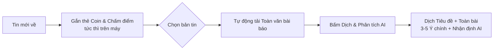

# Tin Tức Nóng (Breaking News) & Phân Tích AI

Theo dõi tin tức thị trường crypto và vĩ mô theo thời gian thực ngay bên dưới biểu đồ mà không cần chuyển sang trình duyệt. Khung **Breaking News** kết hợp danh sách tin đa nguồn, đọc toàn văn bài báo, dịch & tóm tắt AI theo yêu cầu và thông báo Toast linh hoạt.

:::tip Dùng Miễn Phí — AI Tùy Chọn
Bạn có thể đọc tin mới, lọc theo mã coin/xu hướng và xem toàn văn bài báo ngay lập tức không cần API key. Chỉ cần kết nối tài khoản AI (hỗ trợ bản miễn phí hoặc Ollama chạy offline) khi bạn muốn dùng tính năng **Dịch toàn bài**, **Ý chính** và **Đánh giá tác động thị trường**.
:::

---

## 1. Mở & Tùy Chỉnh Kích Thước Khung Tin Tức

Bạn có thể bật hoặc tắt khung Breaking News bất cứ lúc nào:
- Nhấn phím tắt **<kbd>Ctrl</kbd> + <kbd>B</kbd>**, hoặc
- Vào menu **View → Breaking News Panel**, hoặc
- Nhấn biểu tượng **Breaking News** ở góc phải thanh công cụ phía trên (hiển thị huy hiệu đếm số tin mới chưa đọc — tối đa `99+` và tự chuyển màu cam đỏ khi có tin nóng Breaking/tác động cao), hoặc
- Nhấn trực tiếp vào thẻ **`Tin mới: N`** trên **Thanh Trạng Thái (Status Bar)** ở góc dưới bên phải (tự xuất hiện khi có tin mới chưa đọc; bấm vào sẽ mở ngay khung Breaking News).

### Điều Chỉnh Bố Cục Linh Hoạt
- **Kéo đổi chiều cao**: Kéo thanh chia ngang giữa biểu đồ và khung Breaking News.
- **Phóng to hết vùng biểu đồ**: Nhấn nút **Phóng to** (`⛶`) ở góc phải thanh tab — hoặc **nhấp đúp trực tiếp vào tiêu đề tab `Breaking News`** — để mở rộng khung tin tức chiếm 100% không gian biểu đồ khi cần đọc sâu. Nhấn **Thu nhỏ** (hoặc nhấp đúp lần nữa) để quay lại biểu đồ.
- **Tỷ lệ 1/3 Danh sách : 2/3 Nội dung (hoặc xem toàn màn hình danh sách)**: Mặc định cột danh sách bên trái chiếm 1/3 và khung đọc bên phải chiếm 2/3. Nhấn nút **Ẩn/Hiện khung đọc** để thu gọn cột phải và xem toàn bộ danh sách tin theo chiều rộng 100%; nhấp đúp vào một bản tin để mở lại khung đọc.

---

## 2. Lọc Tin Nhanh & Chuyển Nhanh Sang Biểu Đồ

Thanh công cụ gọn phía trên giúp bạn tập trung đúng tin quan trọng:

| Bộ lọc / Nút | Chức năng |
|---|---|
| **All (Tất cả)** | Hiển thị toàn bộ tin tức mới nhất từ các nguồn đang bật. |
| **Breaking (Tin nóng)** | Lọc các tin khẩn cấp và tin có điểm tác động cao. |
| **Chart (Theo biểu đồ)** | Tự động lọc tin liên quan đến đồng coin bạn đang mở trên biểu đồ (ví dụ `BTC`, `ETH`, `SOL`). |
| **Bullish / Bearish** | Lọc theo sắc thái tích cực hoặc tiêu cực. |
| **Nguồn tin & Tìm kiếm** | Lọc theo từng trang báo hoặc tìm theo từ khóa/mã coin. |
| **Thẻ Coin (`BTC`, `ETH`...)** | Bấm vào thẻ coin trên bản tin để chuyển biểu đồ sang cặp giao dịch tương ứng. |

---

## 3. Đọc Toàn Văn Bài Báo & Dịch Chủ Động Bằng AI

Trên thanh công cụ của khung đọc bên phải, bạn có các nút thao tác nhanh:
- **Dịch & Phân tích AI**: Dịch tiêu đề, tóm tắt và **toàn bộ nội dung bài báo** sang ngôn ngữ bạn chọn, đồng thời rút trích **3–5 Ý chính**, chấm **Điểm tác động (1–10)** và **Nhận định AI**.
- **Đổi Bản dịch / Nguyên bản**: Chuyển đổi tức thì giữa bản dịch và tiếng gốc chỉ với 1 cú nhấp chuột.
- **Tải lại toàn văn**: Tải lại đầy đủ nội dung bài báo từ trang gốc nếu nguồn RSS chỉ cung cấp đoạn mở đầu ngắn.
- **Gửi sang AI Copilot**: Đưa toàn bộ bài báo sang khung **AI Copilot** (<kbd>Ctrl</kbd> + <kbd>J</kbd>) để hỏi sâu thêm dựa trên biểu đồ hiện tại.
- **Sao chép Link / Sao chép Toàn văn / Mở trang gốc**: Sao chép đường dẫn, toàn bộ nội dung bài viết hoặc mở trực tiếp trên trình duyệt.

:::note Cuộn Riêng Trong Khung AI Trả Lời
Khi bài báo có phần phân tích AI dài, thẻ **Đánh giá AI & Ý chính** có thanh cuộn riêng rất mượt (hỗ trợ cả chuột lẫn cảm ứng). Khi cuộn chạm đỉnh hoặc đáy của khung AI, thao tác cuộn sẽ tự động chuyển tiếp xuống phần toàn văn bài báo bên dưới.
:::

---

## 4. Cài Đặt Nhanh (Quick Settings) & Thêm Nguồn Tin Tùy Chỉnh

Nhấn nút **Cài đặt nhanh** (kèm nhãn ngôn ngữ như `VI` hoặc `EN`) ngay trên thanh công cụ Breaking News để tinh chỉnh tức thì:
- **Ngôn ngữ dịch đích**: Chọn *Theo ngôn ngữ ứng dụng* hoặc chọn cố định Tiếng Việt, Tiếng Anh, Tiếng Nhật, Tiếng Hàn, Tiếng Trung...
- **Tự động dịch AI (Auto Translate)**: Mặc định **Tắt** để bạn chủ động kiểm soát hạn mức API. Bạn có thể bật lên và chọn phạm vi *Chỉ tin Breaking / Tác động cao* hoặc *Tất cả tin mới*.
- **Tự động tải toàn văn khi chọn tin**: Tự động lấy nội dung đầy đủ khi bạn bấm vào một bản tin.
- **Thông báo Toast Breaking News**: Bật/tắt thẻ thông báo nổi khi có tin mới quan trọng.

### Quản Lý Nguồn Tin tại Settings → News & Feeds

Nhấn biểu tượng **Bánh răng (Settings)** trên thanh công cụ Breaking News (hoặc vào **Tools → Settings → News & Feeds**) để:
- Bật/tắt từng nguồn tin mặc định.
- **Thêm nguồn tin tùy chỉnh**: Nhập URL RSS, Atom hoặc JSON Feed bất kỳ, đặt chu kỳ cập nhật và bấm **Kiểm tra nguồn (Test Feed)** trước khi lưu.
- Bật **Gửi tin tức đã tổng hợp & dịch bằng AI qua Telegram** kèm nút gửi tin mẫu kiểm tra kết nối ngay tại chỗ.

---

## 5. Thông Báo Tin Tức AI Qua Telegram

Ngoài việc đọc tin trực tiếp trên biểu đồ, PTView có thể tự động tóm tắt các điểm nhấn quan trọng, dịch sang ngôn ngữ của bạn và gửi ngay về điện thoại hoặc nhóm Telegram.

### Thiết Lập Nhanh Trong 3 Bước
1. **Thêm Bot Telegram**: Gắn ít nhất 1 bot đang bật tại **Cài đặt → Thông báo** (xem hướng dẫn [Tạo & Gắn Bot Telegram](telegram-bot-setup.md)). Nếu bạn bật từ 2 bot trở lên, bạn có thể chọn **1 bot dùng riêng cho Tin tức** hoặc dùng chung bot mặc định.
2. **Kết nối Tài khoản AI**: Đảm bảo bạn đã bật ít nhất 1 tài khoản AI trong **AI Settings** để tóm tắt & dịch tin. Với **gói Pro Edition**, khi có từ 2 tài khoản AI trở lên, PTView tự động xoay vòng sang tài khoản dự phòng nếu gặp giới hạn tốc độ (HTTP 429).
3. **Bật & Tinh Chỉnh Bộ Lọc**: Trong **Cài đặt → News & Feeds** (hoặc **Thông báo → Tin tức Nóng**):
   - Chọn **Ngưỡng tác động tối thiểu** (*Thấp*, *Trung bình*, *Cao — mặc định*, hoặc *Chỉ Khẩn cấp*).
   - Tùy chọn **Lọc theo Watchlist / Biểu đồ đang mở** để chỉ nhận tin liên quan đến các mã coin bạn theo dõi.
   - Bấm **Gửi tin mẫu thử nghiệm Telegram** để kiểm tra bố cục tin nhắn.

### Gửi Thủ Công Từ Bất Kỳ Bài Báo Nào
- Trên thanh công cụ của khung đọc tin hoặc trong menu chuột phải của mỗi bản tin, bấm **Gửi tóm tắt AI qua Telegram** để tổng hợp, dịch thuật (nếu bài chưa dịch) và đẩy ngay bài báo đó sang Telegram.
- Một khi bài báo đã được gửi thành công tới một tài khoản bot Telegram, PTView sẽ ghi nhớ cả sau khi khởi động lại để không gửi lặp lại tin đó nữa — trừ khi bạn đổi sang tài khoản bot Telegram khác hoặc cập nhật token / chat ID mới trong Cài đặt.

:::tip Khi Chưa Cấu Hình Tài Khoản AI
Nếu chưa bật tài khoản AI nào, tính năng tự gửi sẽ tạm dừng để tránh gửi tin thô chưa tóm tắt (ứng dụng sẽ hiển thị thông báo nhắc cấu hình AI). Bạn vẫn có thể bấm **Gửi bản gốc** trực tiếp trên thông báo nhắc khi gửi thủ công, hoặc bật tùy chọn **Gửi bản gốc rút gọn nếu AI không khả dụng** trong phần Cài đặt.
:::
