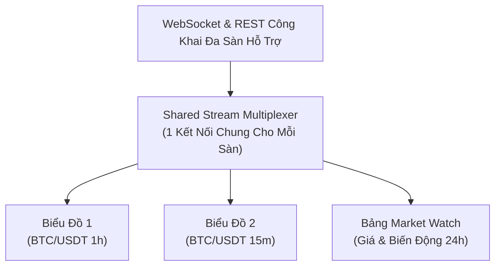

# Dữ Liệu Thị Trường Đa Sàn

PTView kết nối trực tiếp từ máy của bạn tới **nhiều sàn giao dịch tiền mã hóa được hỗ trợ** qua `CryptoClients.Net` để hiển thị nến, giá 24h và sổ lệnh thời gian thực hoàn toàn qua **API dữ liệu công khai**.

---

## Phạm Vi Đa Sàn & Khả Dụng Theo Khu Vực

PTView hỗ trợ kết nối công khai cho các nhóm hợp đồng **Spot**, **Perpetual (`PERP`)**, **Inverse** và **Hợp đồng kỳ hạn (`FUTURES`)**. Tùy theo **quy định pháp lý từng khu vực, điều khoản dịch vụ của từng sàn và trạng thái vận hành**, danh sách sàn cùng loại thị trường khả dụng được điều phối linh hoạt qua cấu hình ký số Remote Care, đồng thời bạn có thể bật/tắt trong **Setup Wizard** hoặc **Settings → Exchanges**:

| Phạm Vi Thị Trường | Khả Dụng |
|---|---|
| **Spot / Perpetual / Inverse / Delivery** | Bật/tắt theo từng sàn hỗ trợ phù hợp quy định khu vực, điều khoản từng sàn và cài đặt cá nhân |

:::info Tuyên Bố Độc Lập Với Các Sàn
PtView Workstation là phần mềm phân tích kỹ thuật độc lập, **không liên kết, không được tài trợ, bảo trợ hay ủy quyền bởi bất kỳ sàn giao dịch tiền mã hóa bên thứ ba nào được kết nối trong Phần mềm**. Dữ liệu thị trường công khai được kết nối trực tiếp từ thiết bị người dùng qua API công khai của từng sàn và tuân theo điều khoản dịch vụ của các sàn đó; tính năng, danh sách sàn và loại thị trường hỗ trợ có thể thay đổi linh hoạt theo pháp lý khu vực và điều khoản sàn.
:::

---

## Cơ Chế Chia Sẻ Luồng Dữ Liệu (Tiết Kiệm Băng Thông)

Thay vì mở nhiều kết nối socket riêng cho từng tab biểu đồ, PTView gộp chung luồng dữ liệu cho mỗi sàn và phân phối tới toàn bộ biểu đồ và bảng Market Watch:

- **Không Tốn Băng Thông Thừa**: Mở 4 khung giờ của cùng 1 cặp coin chỉ tiêu tốn băng thông bằng mở 1 biểu đồ.
- **Tự Động Bù Nến Thiếu (Gap Recovery)**: Khi rớt mạng hoặc đổi VPN, hệ thống tự phát hiện đoạn nến bị thiếu và tải bổ sung ngay khi có mạng lại.

---

## Sử Dụng Market Watch & Tìm Kiếm Mã Nhanh

- **Bật/Tắt Market Watch (<kbd>Ctrl</kbd> + <kbd>M</kbd>)**: Tự động đồng bộ theo sàn đang chọn trên thanh công cụ chính. Lọc nhanh theo **Yêu thích (`★`)**, loại thị trường (chỉ hiển thị những loại sàn đang chọn hỗ trợ và đang bật như **SPOT**, **PERP**, **INVERSE**, **FUTURES**), hoặc bấm kính lúp để gõ lọc tên coin tức thì.
- **Gắn Sao Yêu Thích (`★`)**: Bấm biểu tượng ngôi sao trực tiếp ở đầu mỗi dòng trong **Market Watch** hoặc **Tìm Mã Nhanh (<kbd>Ctrl</kbd> + <kbd>K</kbd>)** (hoặc **chuột phải → Đánh dấu / Bỏ đánh dấu Yêu thích**). Các mã đã gắn sao sẽ được ghim lên đầu danh sách, đồng bộ tức thời giữa hai nơi và tự động lưu lại.
- **Menu Chuột Phải**: Mở nhanh mã ở biểu đồ hiện tại hoặc tab mới, gắn/bỏ yêu thích, sao chép tên cặp, hoặc ẩn/hiện cột (`Last`, `24h %`, `24h High`, `24h Low`, `24h Vol`, `Exchange`).
- **Tìm Mã Nhanh (<kbd>Ctrl</kbd> + <kbd>K</kbd>)**: Chuyển nhanh sang bất kỳ cặp nào trên tất cả các sàn đang bật. Bạn có thể bấm gắn sao nhiều mã liên tiếp mà không bị đóng popup, hoặc bật nút lọc `★` để chỉ xem danh sách yêu thích; bộ lọc loại thị trường tự cập nhật ngay khi đổi sàn.

---

## Tùy Chỉnh Market Type Riêng Từng Sàn & Proxy Mạng

1. Mở **Settings** (<kbd>Ctrl</kbd> + <kbd>P</kbd>) → **Exchanges**.
2. Tick bật/tắt những sàn bạn muốn hiển thị trong Market Watch và thanh tìm kiếm nhanh.
3. Ngay bên dưới tên mỗi sàn, bạn có thể tick bật/tắt riêng từng loại thị trường (**SPOT**, **PERP**, **INVERSE**, **FUTURES**). Mỗi sàn chỉ hiển thị đúng những loại thị trường mà sàn đó thực sự hỗ trợ.
4. Nếu muốn áp dụng nhanh hàng loạt cho mọi sàn có hỗ trợ, dùng 4 tùy chọn ở thẻ **Loại công cụ giao dịch** bên dưới rồi bấm **Save**.
5. Nếu mạng nội bộ hoặc nhà mạng chặn kết nối sàn, bật **HTTP / SOCKS5 Proxy**, nhập Host & Port và bấm **Save** — hiệu lực tức thì không cần khởi động lại app.

:::note Tạm Khóa Bảo Trì Theo Loại Thị Trường
Nếu một loại thị trường của sàn hiện nhãn `(Locked)` trong **Settings → Exchanges** hoặc báo chú thích bảo trì trên thanh công cụ, mảng thị trường đó đang tạm giới hạn từ Remote Care. Các tab biểu đồ đang mở sẵn vẫn được giữ nguyên nét vẽ kỹ thuật, còn danh sách tìm kiếm và Market Watch tạm ẩn loại đó cho tới khi hoạt động lại bình thường.
:::

:::tip Chỉ Đọc Dữ Liệu Công Khai — Chỉ Lưu Key AI & Telegram Trên Máy
Mọi chức năng xem biểu đồ nến, sổ lệnh L2, Funding Rate và Open Interest sử dụng **API dữ liệu công khai của sàn**. PTView không kết nối tài khoản giao dịch sàn hay yêu cầu API key sàn — các khóa xác thực duy nhất lưu cục bộ chỉ gồm **khóa API nhà cung cấp AI** và **Token Bot Telegram** (nếu bạn tự bật).
:::
