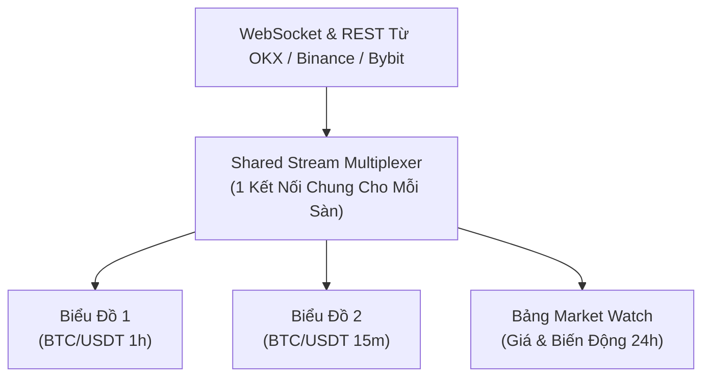

# Dữ Liệu Thị Trường & Kết Nối 3 Sàn Giao Dịch

PTView kết nối trực tiếp tới **3 sàn giao dịch tiền mã hóa trọng tâm** (`OKX`, `Binance` và `Bybit`) qua `CryptoClients.Net` để hiển thị nến, giá 24h và sổ lệnh thời gian thực — **không cần API key sàn để xem biểu đồ**.

---

## Danh Sách 3 Sàn Giao Dịch Hỗ Trợ (`OKX`, `Binance`, `Bybit`)

`OKX`, `Binance`, và `Bybit` được bật sẵn khi mở app lần đầu. Bạn có thể bật hoặc tắt bất kỳ sàn nào trong **Setup Wizard** hoặc **Settings → Exchanges**:

| Nhóm Thị Trường | Các Sàn Hỗ Trợ |
|---|---|
| **Spot + Perpetual + Delivery** | `OKX`, `Binance`, `Bybit` |

:::info Tuyên Bố Độc Lập Với Các Sàn
PtView Workstation là phần mềm phân tích kỹ thuật độc lập, **không liên kết, không được tài trợ hay ủy quyền bởi OKX, Binance hoặc Bybit**. Dữ liệu thị trường công khai được kết nối trực tiếp từ thiết bị người dùng qua API chính thức của từng sàn và tuân theo điều khoản dịch vụ của các sàn đó; tính năng và sàn hỗ trợ có thể thay đổi theo điều khoản của sàn.
:::

---

## Cơ Chế Chia Sẻ Luồng Dữ Liệu (Tiết Kiệm Băng Thông)

Thay vì mở nhiều kết nối socket riêng cho từng tab biểu đồ, PTView gộp chung luồng dữ liệu cho mỗi sàn và phân phối tới toàn bộ biểu đồ và bảng Market Watch:

- **Không Tốn Băng Thông Thừa**: Mở 4 khung giờ của cùng 1 cặp coin chỉ tiêu tốn băng thông bằng mở 1 biểu đồ.
- **Tự Động Bù Nến Thiếu (Gap Recovery)**: Khi rớt mạng hoặc đổi VPN, hệ thống tự phát hiện đoạn nến bị thiếu và tải bổ sung ngay khi có mạng lại.

---

## Sử Dụng Market Watch & Tìm Kiếm Mã Nhanh

- **Bật/Tắt Market Watch (<kbd>Ctrl</kbd> + <kbd>M</kbd>)**: Lọc theo sàn, loại thị trường (**ALL**, **SPOT**, **PERP**, **INVERSE**), hoặc bấm kính lúp để gõ lọc tên coin tức thì.
- **Menu Chuột Phải**: Mở nhanh mã ở biểu đồ hiện tại hoặc tab mới, sao chép tên cặp, hoặc ẩn/hiện cột (`Last`, `24h %`, `24h High`, `24h Low`, `24h Vol`, `Exchange`).
- **Tìm Mã Nhanh (<kbd>Ctrl</kbd> + <kbd>K</kbd>)**: Chuyển nhanh sang bất kỳ cặp nào trên tất cả các sàn đang bật.

---

## Tùy Chọn: Cấu Hình API Key Sàn & Proxy Mạng

1. Mở **Settings** (<kbd>Ctrl</kbd> + <kbd>P</kbd>) → **Exchanges**.
2. Tick bật/tắt những sàn bạn muốn hiển thị trong Market Watch và thanh tìm kiếm nhanh.
3. Nếu mạng nội bộ hoặc nhà mạng chặn kết nối sàn, bật **HTTP / SOCKS5 Proxy**, nhập Host & Port và bấm **Save** — hiệu lực tức thì không cần khởi động lại app.

:::tip Không Cần API Key Để Xem Biểu Đồ
Mọi chức năng xem biểu đồ nến, sổ lệnh L2, Funding Rate và Open Interest hoạt động hoàn toàn **không cần nhập API Key sàn**. Bạn chỉ cần thêm API Key (khuyến nghị Read-Only) khi muốn xem số dư tài khoản cá nhân.
:::
