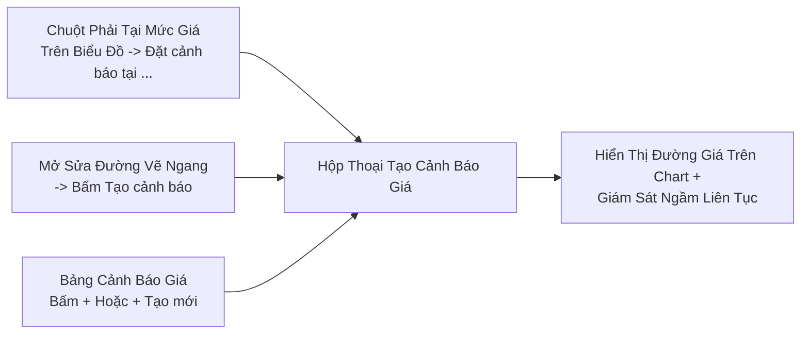

# Cảnh Báo Mức Giá & Chỉ Báo Kỹ Thuật (Pro)

Không bao giờ bỏ lỡ điểm bứt phá (breakout), nhịp hồi, điểm giao cắt chỉ báo hay vùng hỗ trợ/kháng cự quan trọng. **Hệ thống Cảnh báo PTView** theo dõi thị trường theo thời gian thực trên **các sàn giao dịch đang bật**, vẽ mốc giá lên biểu đồ và báo ngay qua **Toast**, **Âm thanh** và **Telegram**.

:::tip Chạy Ngầm Ngay Cả Khi Đóng Tab
Toàn bộ cảnh báo chạy trực tiếp trên máy của bạn bằng luồng dữ liệu công khai theo thời gian thực (nếu bật báo Telegram, phần mềm chỉ dùng Token Bot Telegram lưu cục bộ). Khi đã kích hoạt, PTView vẫn tiếp tục theo dõi cặp tiền và khung giờ đó ngay cả khi bạn đóng tab biểu đồ và tự động lưu toàn bộ danh sách giữa các lần mở app.
:::

---

## 1. Ba Cách Đặt Cảnh Báo Giá Siêu Nhanh

1. **Chuột Phải Trực Tiếp Trên Biểu Đồ** *(Nhanh nhất)*:
   - Nhấp chuột phải đúng vị trí mức giá bạn muốn canh và chọn **Đặt cảnh báo tại ...**.
   - PTView tự động điền sẵn sàn, mã giao dịch, mức giá mục tiêu và gợi ý thông minh **Cắt lên** (nếu giá đặt cao hơn giá hiện tại) hoặc **Cắt xuống** (nếu thấp hơn).
2. **Tạo Từ Đường Vẽ Ngang (Horizontal Line)**:
   - Kẻ một **Đường ngang (Horizontal Line)** trên biểu đồ, chỉnh màu tùy thích, nhấp đúp (hoặc bấm nút Sửa trên thanh nổi) rồi bấm **Tạo cảnh báo**.
   - Cảnh báo mới sẽ tự động kế thừa cả **mức giá** lẫn **màu sắc** của đường vẽ đó.
3. **Từ Bảng Cảnh Báo Giá (Right Drawer)**:
   - Bấm biểu tượng **Chuông** ở góc phải thanh công cụ trên cùng (hoặc **Xem → Cảnh báo giá**, hoặc bấm thẻ **Alerts** ở thanh trạng thái dưới cùng), sau đó bấm dấu **`+`** hoặc **`+ Tạo mới`**.

---

## 2. Điều Kiện Kích Hoạt, Đổi Màu & Nhãn `%` Trên Biểu Đồ

Trong hộp thoại **Tạo / Chỉnh sửa cảnh báo giá** (có thanh cuộn mượt phù hợp mọi kích thước màn hình), bạn có thể tùy chỉnh đầy đủ:

### Các Điều Kiện So Sánh Giá
| Điều kiện | Ký hiệu | Khi nào kích hoạt |
|---|---|---|
| **Cắt qua (Hai chiều)** | `×` | Giá cắt ngang qua mức mục tiêu theo chiều đi lên hoặc đi xuống |
| **Cắt lên** | `↗` | Giá cắt từ dưới vượt lên chạm hoặc cao hơn mức mục tiêu |
| **Cắt xuống** | `↘` | Giá cắt từ trên rơi xuống chạm hoặc thấp hơn mức mục tiêu |
| **Lớn hơn hoặc bằng** | `≥` | Giá hiện tại bằng hoặc cao hơn mức mục tiêu |
| **Nhỏ hơn hoặc bằng** | `≤` | Giá hiện tại bằng hoặc thấp hơn mức mục tiêu |

### Tùy Chọn Nhanh, Tần Suất & Màu Sắc
- **Nút Chỉnh Giá Nhanh (`-5%`, `-1%`, `Hiện tại`, `+1%`, `+5%`)**: Đặt giá mục tiêu nhanh theo phần trăm so với giá thị trường và xem trước mức chênh lệch `% so với hiện tại` theo thời gian thực.
- **Tần Suất (Trigger)**:
  - **Chỉ một lần (Only Once)**: Kích hoạt đúng 1 lần rồi chuyển sang trạng thái **Đã khớp** và ghi vào **Lịch sử**.
  - **Mỗi lần (Lặp lại)**: Tiếp tục canh và kích hoạt lại mỗi khi thỏa điều kiện, đảm bảo nghỉ tối thiểu theo **Thời gian chờ (giây)** (`5` – `86.400` giây).
- **Thời Hạn**: Chọn **Không hết hạn**, **1 giờ**, **24 giờ**, **7 ngày** hoặc **30 ngày**.
- **Màu Đường Cảnh Báo & Tên Cảnh Báo**: Chọn màu tùy ý cho từng đường cảnh báo cùng **Tên cảnh báo** và **Ghi chú / Nội dung**.
  - Đường cảnh báo hiển thị bằng đường đứt nét đúng màu đã chọn, nhãn giá trên trục Y và thẻ mô tả gọn dạng **`🔔 ↗ +2.50% · Breakout`** đặt chênh lệch `+/- %` trực tiếp ngay trước tên cảnh báo.
  - **Kéo Thả Sửa Giá Mục Tiêu Trực Tiếp Trên Biểu Đồ**: Di chuột lên bất kỳ đường cảnh báo nào (hoặc thẻ `🔔`) đang hiện trên biểu đồ — con trỏ sẽ chuyển sang mũi tên kéo dọc `↕` và đường kẻ tự động nhấn nhẹ để nhận biết. Nhấn giữ và kéo lên/xuống để xem trước mức giá mới, `%` chênh lệch trực tiếp và đường mờ tại vị trí cũ (hỗ trợ tự bắt dính **Magnet** nếu đang bật), rồi thả chuột để cập nhật ngay lên mọi biểu đồ mở và bảng **Cảnh báo giá** (nhấn <kbd>Esc</kbd> hoặc chuột phải trong lúc kéo để hủy).
  - Màu đường, nền nhãn và chữ tự động cân chỉnh sắc nét theo cả 4 giao diện (**Dark**, **Midnight**, **CyberNavy** và **Light**).

---

## 3. Quản Lý Danh Sách & Lịch Sử Trong Bảng Bên Phải

Bấm biểu tượng **Chuông** trên thanh công cụ (hoặc **Xem → Cảnh báo giá**) để mở bảng **Cảnh báo giá**:

- **Thanh Tiêu Đề Gọn**:
  - Bấm **`+`** để tạo nhanh cảnh báo cho biểu đồ đang mở.
  - Bấm nút **`🕒 <số lượng>`** để chuyển đổi qua lại giữa danh sách **Cảnh báo** và **Lịch sử** kích hoạt.
  - Bấm dấu **`⋮`** (*Tùy chọn khác*) để mở menu thu gọn ngay trên thanh tiêu đề:
    - **Hiện tất cả đường cảnh báo** / **Ẩn tất cả đường cảnh báo**: Bật hoặc ẩn toàn bộ đường cảnh báo trên biểu đồ chỉ với một lần bấm (giữ nguyên giám sát giá chạy ngầm).
    - **Làm sáng đường đang chọn**: Bật/tắt nhanh chế độ làm nổi bật đường cảnh báo trên biểu đồ theo mục đang chọn.
    - **Chế độ thu gọn**: Chuyển nhanh danh sách cảnh báo và lịch sử giữa dạng hàng 2 dòng siêu gọn (hiển thị nhiều gấp ~3 lần trên màn hình, đầy đủ thông tin khi di chuột) và thẻ **Chi tiết (Mặc định)**.
    - **Xóa đã khớp** / **Xóa lịch sử**: Dọn nhanh các cảnh báo đã hoàn tất (`Triggered` / `Expired`) hoặc nhật ký cũ mà không chiếm thanh chân trang bên dưới.
- **Tìm Kiếm & Thẻ Lọc Nhanh**:
  - Gõ vào ô **Lọc mã hoặc ghi chú...** (bấm `×` để xóa nhanh).
  - Lọc 1 chạm theo **Tất cả**, **Đang bật**, **Tạm dừng**, **Đã khớp**, **Chỉ báo**, hoặc **Mã hiện tại** (chỉ hiện cảnh báo của cặp coin đang xem).
- **Thao Tác & Tick Kênh Nhanh Ngay Trên Từng Thẻ**:
  - **Chọn Thẻ & Làm Nổi Viền Accent**: Bấm vào bất kỳ thẻ cảnh báo hoặc lịch sử nào để làm nổi viền thẻ bằng **màu Accent** của giao diện đang dùng, giúp nhận biết rõ mục đang xem (bấm vùng trống hoặc phím <kbd>Esc</kbd> để bỏ chọn).
  - **Mở trên biểu đồ**: Bấm vào tên mã coin trên thẻ — hay bấm nút **Open Chart** trên thông báo Toast — để nhảy thẳng tới đúng sàn, thị trường, cặp tiền và tự động khớp **khung thời gian** cho cảnh báo chỉ báo.
  - **Tick Nhanh Kênh Thông Báo (`Toast` / `Âm thanh` / `Tele`)**: Bật/tắt trực tiếp từng kênh cho từng cảnh báo ngay ngoài thẻ mà không cần mở lại hộp thoại Sửa.
  - **Hiển Thị Đường & Vòng Đời**: Với cảnh báo mức giá, bấm icon **Con mắt** để **Ẩn / Hiện đường cảnh báo trên biểu đồ** độc lập với trạng thái bật/tắt (khi ẩn, chấm màu trước giá dịu xuống nhẹ nhưng cảnh báo `Active` vẫn theo dõi tick và gửi Toast/Âm thanh/Telegram bình thường). Ngoài ra có thể bấm **Tạm dừng / Tiếp tục**, **Kích hoạt lại (Re-arm)** cho cảnh báo đã khớp hoặc hết hạn, **Chỉnh sửa** (icon bút chì) và **Xóa** (icon thùng rác).

---

## 4. Cảnh Báo Chỉ Báo Kỹ Thuật *(Phiên Bản Pro)*

Có sẵn trong **PTView Pro** (và trọn vẹn trong **28 ngày Dùng thử Pro miễn phí**), **Cảnh báo Chỉ báo (Indicator Alerts)** theo dõi tự động **hơn 40 chỉ báo tích hợp sẵn** cũng như các **Plugin C# `PTView.SDK`** tùy biến trên mọi sàn, mọi cặp coin và mọi khung thời gian (`1m` – `1w`) — hoạt động liên tục ngay cả khi bạn đóng tab biểu đồ.

### Hai Cách Tạo Cảnh Báo Chỉ Báo Siêu Nhanh
1. **Bấm Chuông 1 Chạm Ngay Trên Chỉ Báo Biểu Đồ** *(Nhanh nhất)*:
   - Rê chuột lên tên chỉ báo lớp phủ (ví dụ `EMA(20)`, `Bollinger Bands`, `SuperTrend`) hoặc tiêu đề khung chỉ báo phụ (`RSI(14)`, `MACD(12,26,9)`), rồi bấm biểu tượng **Chuông màu vàng (`🔔`)**.
   - PTView tự mở hộp thoại tạo cảnh báo với sẵn sàn, cặp tiền, khung thời gian, chỉ báo, đường vẽ và toàn bộ tham số bạn đang gắn trên biểu đồ.
2. **Tạo Từ Hộp Thoại Cảnh Báo**:
   - Bấm dấu **`+`** trong bảng **Cảnh báo** và chuyển nút chọn đầu hộp thoại từ **Mục tiêu Giá** sang **Chỉ báo `PRO`**.

### Ba Chế Độ So Sánh Linh Hoạt
| Kiểu So Sánh | Ví Dụ Thực Tế | Khi Nào Nên Dùng |
|---|---|---|
| **Chỉ báo vs Giá trị** | `RSI(14) ↗ 70`, `CCI(20) ↘ -100`, `MACD Histogram ≥ 0` | Canh vùng quá mua/quá bán hoặc cắt mốc 0 (hỗ trợ đầy đủ số dương, số âm và số `0`, kèm nút chọn nhanh mức tham chiếu như `30` / `50` / `70`). |
| **Giá vs Chỉ báo** | `Close ↗ EMA(200)`, `Close ↘ BB Upper`, `Close × SuperTrend` | Canh giá đóng/cao/thấp/mở nến vượt lên hoặc cắt xuống đường xu hướng/dải biến động động. |
| **Chỉ báo vs Chỉ báo** | `MACD ↗ Signal`, `Stoch %K ↘ %D`, `EMA(20) ↗ EMA(50)` | Canh điểm giao cắt giữa 2 đường trong cùng một chỉ báo hoặc giữa 2 chỉ báo khác nhau với bộ tham số riêng biệt. |

### Thời Điểm Kiểm Tra: Khi Đóng Nến vs. Thời Gian Thực
- **Khi đóng nến — On Bar Close** *(Mặc định khuyên dùng)*: Chỉ kiểm tra điều kiện **1 lần duy nhất khi cây nến của khung thời gian đã chọn chính thức đóng lại**, giúp lọc sạch râu nến quét nhiễu và breakout giả, đồng thời giữ CPU cực kỳ nhẹ nhàng.
- **Thời gian thực — Intrabar**: Theo dõi liên tục theo từng nhịp tick trong nến đang chạy và tuân thủ **Thời gian chờ lặp lại (giây)** khi chọn chế độ lặp.

:::info Tiết Kiệm Tài Nguyên & Tự Bảo Toàn Khi Hết Hạn Pro
- **Dùng Chung Luồng Dữ Liệu**: Khi đặt nhiều cảnh báo chỉ báo trên cùng cặp tiền và khung giờ, hệ thống tự dùng chung một luồng nến trực tiếp và hiển thị giá trị live (`Now: ...`) ngay trên thẻ khi bạn mở bảng Cảnh báo.
- **Tự Tạm Dừng An Toàn (Không Bao Giờ Xóa)**: Nếu hết hạn Dùng thử 28 ngày hoặc hết hạn Pro và chuyển về bản Community, toàn bộ cảnh báo chỉ báo đang chạy sẽ **tự chuyển sang Tạm dừng (kèm nhãn `PRO`) chứ không bị xóa**. Ngay khi bạn nâng cấp lại Pro, hệ thống tự động kích hoạt lại đầy đủ.
:::

---

## 5. Đồng Bộ Cài Đặt Mặc Định & Chuyển Tiếp Qua Telegram

Nhấn <kbd>Ctrl</kbd> + <kbd>P</kbd> (hoặc **Công cụ → Tùy chọn**) và mở **Thông báo → Cảnh báo mức giá mục tiêu**:

| Tùy chọn | Tác dụng |
|---|---|
| **Hiển thị thông báo Toast khi đạt giá** | Hiện thông báo Toast trong app khi đang mở PTView, hoặc Toast nổi ngoài màn hình Windows (kèm nút **Open Chart**) khi thu nhỏ hoặc chuyển sang ứng dụng khác. |
| **Phát âm thanh cảnh báo giá** | Phát âm thanh nhóm **Alert** khi kích hoạt (có thể chỉnh âm lượng, tắt âm khi đang focus hoặc chọn file `.wav` / `.mp3` riêng tại **Cài đặt → Âm thanh → Alert**). |
| **Gửi cảnh báo giá qua Telegram** | Gửi tin nhắn cảnh báo ngay về Bot Telegram của bạn. |
| **Bot Telegram cho cảnh báo giá** | Khi có từ 2 bot đang bật trở lên, cho phép chọn riêng 1 tài khoản bot dùng cho cảnh báo giá (hoặc giữ theo bot mặc định chung). |
| **Thời gian chờ lặp lại mặc định (giây)** | Điền sẵn thời gian nghỉ mặc định (`5` – `86.400s`) cho các cảnh báo chế độ lặp lại mới tạo. |
| **Làm sáng đường cảnh báo đang chọn trên biểu đồ** | Tăng độ sáng cho đường kẻ, nhãn thẻ và mốc giá trên trục biểu đồ đồng thời làm dịu nhẹ các đường khác khi bạn chọn mục trong danh sách (**mặc định: Tắt**). |
| **Chế độ hiển thị mục cảnh báo** | Chọn **Chi tiết (Mặc định)** để hiện thẻ đầy đủ checkbox `Toast` / `Âm thanh` / `Tele` & ghi chú, hoặc **Thu gọn** để nén gọn mỗi mục thành 2 dòng kèm tooltip chi tiết khi di chuột. |

:::info Cách Hoạt Động Khóa Telegram & Chọn Tài Khoản Bot
- **Khi chưa có Bot Telegram nào được thêm hoặc bật**: Để tránh hiểu nhầm rằng Telegram đang hoạt động, toàn bộ nút bật và checkbox **Gửi qua Telegram / Tele** trong Cài đặt, hộp thoại Tạo/Sửa và từng thẻ danh sách sẽ tự động bỏ tick và khóa lại. Sau khi bạn thiết lập và bật bot đầu tiên theo **[Hướng Dẫn Tạo & Gắn Bot Telegram](telegram-bot-setup.md)**, tùy chọn Telegram sẽ tự mở khóa ngay.
- **Khi chỉ có 1 Bot đang bật**: Bot đó tự động trở thành mặc định duy nhất cho cả hệ thống và cảnh báo giá mà không cần chọn lại.
- **Khi có từ 2 Bot đang bật trở lên**: Mục **Bot Telegram cho cảnh báo giá** sẽ hiển thị trong **Cài đặt → Thông báo → Cảnh báo mức giá mục tiêu** để bạn chỉ định 1 bot dùng riêng cho cảnh báo giá hoặc dùng chung bot mặc định hệ thống.
:::

---

## 6. Tạo & Quản Lý Cảnh Báo Bằng AI Copilot & MCP

Bạn có thể yêu cầu **[AI Copilot](ai-copilot.md)** ngay trong app hoặc bất kỳ công cụ AI nào kết nối qua **[MCP Server](mcp-server-and-tools.md)** tạo, kiểm tra, tạm dừng hoặc dọn dẹp cả **Cảnh báo Mức giá** *(Community & Pro)* lẫn **Cảnh báo Chỉ báo Kỹ thuật** *(Pro)* bằng ngôn ngữ tự nhiên:

- **Đặt nhanh theo giá, `%` hoặc chỉ báo kỹ thuật**: Hỏi *"Đặt cảnh báo khi BTC tăng 2.5% so với giá hiện tại"*, *"Tạo cảnh báo đóng nến khung 15m khi RSI(14) cắt lên 70"*, hoặc *"Báo Telegram khi MACD khung H4 của BTC cắt lên Signal"* — AI sẽ gọi `alerts_create` và tự nhận diện sàn/cặp tiền/khung giờ trên biểu đồ đang mở nếu bạn không ghi rõ.
- **Xem lại, chỉnh sửa & dọn dẹp**: Hỏi *"Liệt kê các cảnh báo giá đang chạy"* (`alerts_list`), *"Xem lịch sử cảnh báo đã kích hoạt của ETH"* (`alerts_get_history`), *"Dời giá mục tiêu cảnh báo BTC lên 105.000, ẩn đường vẽ trên chart hoặc tạm dừng"* (`alerts_modify`, `alerts_set_status`), hoặc *"Xóa các cảnh báo đã hoàn tất"* (`alerts_clear`).
- **Mẫu có sẵn trong `⚡ Quick Ask`**: Nhấn nút **`⚡`** trong AI Copilot và chọn nhóm **Cảnh báo** để dùng nhanh 3 mẫu một chạm — *Đặt Cảnh báo Hỗ trợ/Kháng cự*, *Cảnh báo Breakout & Breakdown theo %*, và *Rà soát Cảnh báo Đang chạy & Lịch sử*.
- **Tách biệt an toàn với `/schedule`**: Tác vụ hẹn giờ `/schedule` chỉ được đọc trạng thái qua `alerts_list` và `alerts_get_history` để báo cáo tổng hợp cho bạn; các thao tác tạo, sửa hoặc xóa cảnh báo luôn chỉ thực hiện khi bạn ra lệnh trực tiếp.

