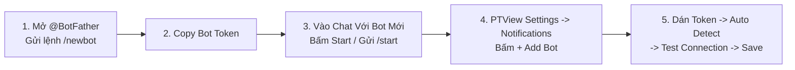

# Hướng Dẫn Tạo & Gắn Bot Telegram Nhận Cảnh Báo

Chỉ mất 2 phút để tạo một Bot Telegram riêng miễn phí và gắn vào PTView — giúp bạn nhận báo cáo thị trường từ AI Copilot, cảnh báo từ lệnh `/schedule` và thông báo tín hiệu ngay trên điện thoại.



---

## Bước 1: Tạo Bot Mới Qua `@BotFather` Trên Telegram

1. Mở ứng dụng **Telegram** (trên điện thoại hoặc máy tính), tìm đúng tài khoản **`@BotFather`** (có dấu tích xanh chính chủ).
2. Bấm **Start** và gửi lệnh:
   ```text
   /newbot
   ```
3. **Đặt tên hiển thị** cho bot (ví dụ: `PTView Cảnh Báo Giá`).
4. **Đặt username** cho bot — bắt buộc kết thúc bằng chữ `bot` và không trùng với ai (ví dụ: `ptview_alert_myname_bot`).
5. `@BotFather` sẽ trả về một đoạn **HTTP API Token** dạng:
   ```text
   1234567890:AAHxxxxxxxxxxxxxxxxxxxxxxxxxxxxxxx
   ```
   Hãy copy lại đoạn Token này.

---

## Bước 2: Kích Hoạt Cuộc Trò Chuyện Với Bot (Rất Quan Trọng)

:::info Tại Sao Phải Nhắn `/start` Trước?
Telegram quy định Bot **không được phép tự nhắn tin cho bạn** nếu bạn chưa chủ động bấm Start nhắn cho Bot trước.
:::

- **Nếu muốn nhận thông báo riêng (DM)**: Bấm vào link `t.me/<username_bot_cua_ban>` trong tin nhắn của `@BotFather`, rồi bấm nút **Start** (hoặc gửi `/start`).
- **Nếu muốn nhận thông báo vào Nhóm (Group)**: Thêm con bot vừa tạo vào nhóm Telegram đó và gửi 1 tin nhắn bất kỳ (ví dụ `/start` hoặc `hello`) trong nhóm.

---

## Bước 3: Gắn Bot Vào PTView (`Settings → Notifications`)

1. Mở **Settings** (<kbd>Ctrl</kbd> + <kbd>P</kbd>) và chọn mục **Notifications** ở cột bên trái.


2. Bấm nút **+ Add Bot** để mở hộp thoại thêm Bot Telegram.


3. Dán **Bot Token** vừa lấy ở Bước 1 vào ô **Bot Token**.
4. Bấm nút **Auto Detect** (Tự động nhận diện) ở dòng **Chat ID**:
   - PTView tự đọc tin nhắn `/start` bạn vừa gửi, tự động điền **Alias** + **Chat ID**, và gửi ngay 1 tin nhắn xác nhận về Telegram của bạn!
5. *(Tùy chọn)* Bấm **Test Connection** bất kỳ lúc nào để kiểm tra kết nối (tự động đi qua HTTP/SOCKS5 Proxy nếu bạn đã bật trong **Settings → Network**).
6. Tick chọn **Enabled** (và **Set as Default** nếu muốn dùng bot này làm mặc định), rồi bấm **Save**.

---

## Bước 4: Dùng Ngay Trong AI Copilot & Lệnh `/schedule`

Mở **AI Copilot** (<kbd>Ctrl</kbd> + <kbd>J</kbd>) và thử các lệnh sau:
- Kiểm tra trạng thái bot: `/notify status`
- Bật gửi thông báo Telegram cho phiên chat hiện tại: `/notify on`
- Đổi giữa nhiều bot (nếu gắn nhiều kênh): `/notify bot <tên_alias>`
- Hẹn AI tự canh chart và báo về Telegram định kỳ:
  ```text
  /schedule every 15m kiểm tra RSI(14) và funding rate BTCUSDT --notify
  ```

:::tip Nếu Bấm `Auto Detect` Không Tìm Thấy Chat ID
1. Mở lại khung chat với Bot trên Telegram và gửi lại `/start`.
2. Quay lại PTView bấm **Auto Detect** ngay sau đó vài giây.
3. Nếu mạng nhà bạn bị chặn kết nối Telegram, hãy bật HTTP/SOCKS5 Proxy trước tại **Settings → Network**.
:::

