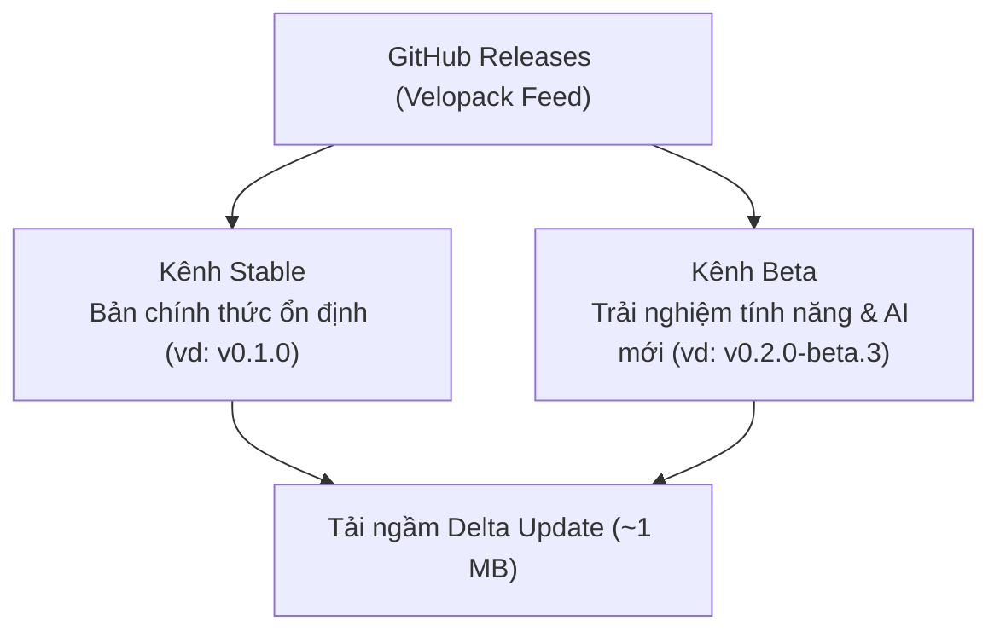

# Phiên Bản, Cài Đặt & Kênh Cập Nhật

PtView Workstation được đóng gói thành một bộ cài đặt hợp nhất duy nhất cho Windows, hỗ trợ cập nhật gia tăng (delta update) tự động qua **Velopack**.

---

## So Sánh Phiên Bản: Community vs. Pro

:::warning Tạm Khóa Tính Năng & Mở Bán Pro Để Xin Cấp Phép Sàn
Trong thời gian xin cấp phép dữ liệu thị trường thương mại từ các sàn (`OKX`, `Binance`, `Bybit`), **tính năng Pro, gói dùng thử Pro 28 ngày và thanh toán nâng cấp hiện đang được tạm khóa** bằng cờ điều khiển trong ứng dụng. Người dùng vẫn có thể tải và sử dụng miễn phí bản **Community Edition**.
:::

Bạn không cần gỡ app hay tải lại file cài khác khi nâng cấp từ Community lên Pro — khi mở bán trở lại, bạn có thể mua trực tiếp trong app qua VietQR hoặc nhập mã bản quyền tại **Cài đặt → Bản quyền**. Xem chi tiết từng bước tại [Hướng Dẫn Nâng Cấp Pro & Thanh Toán](./app/pro-upgrade-and-payment.md).

### Dùng Thử Pro 28 Ngày Miễn Phí
Mỗi máy tính khi cài đặt PTView lần đầu đều tự động có **28 ngày trải nghiệm toàn bộ tính năng Pro** mà không cần đăng ký hay thẻ thanh toán. Sau 28 ngày, ứng dụng tự chuyển về bản **Community (miễn phí vĩnh viễn)** mà vẫn giữ nguyên toàn bộ workspace, cài đặt và nét vẽ của bạn.

| Tính Năng | Community (Miễn Phí) | Pro (hoặc Dùng Thử 28 Ngày) |
|---|---|---|
| **Dữ Liệu Đa Sàn Thời Gian Thực** | OKX, Binance & Bybit (Spot, Perpetual & Futures) | OKX, Binance & Bybit (Spot, Perpetual & Futures) |
| **Số Tab Làm Việc (Workspace Tabs)** | Tối đa **3 tab** | **Không giới hạn** số tab |
| **Số Biểu Đồ Trong Mỗi Tab** | Tối đa **2 biểu đồ** (Đơn / Chia đôi) | Tối đa **4 biểu đồ** (Lưới `2×2`, `1+2`, `1+3`) |
| **Chỉ Báo Trên Mỗi Biểu Đồ** | Tối đa **5 chỉ báo** (có nhãn `X/5`) | **Không giới hạn** số chỉ báo |
| **Plugin C# Ngoài (`PTView.SDK`)** | Chỉ dùng chỉ báo tích hợp sẵn | **Chạy đầy đủ plugin ngoài** (tiến trình cô lập) |
| **AI Copilot & Tự Động Hóa** | Kết nối tài khoản AI tiêu chuẩn | **Đầy đủ ReAct AI** + **Xoay vòng đa tài khoản** |
| **Giao Thức MCP Tools** | Theo hạn ngạch Community | **Toàn quyền gọi toàn bộ 77 công cụ MCP** |
| **Bộ Đệm Lịch Sử Nến** | Tối đa 2.000 nến/khung | Lên đến **50.000+ nến** lưu bền vững |
| **Kích Hoạt Bản Quyền** | Miễn phí trọn đời (không cần key) | **Mã bản quyền Offline ECDSA P-256** |

---

## Hai Cách Cài Đặt Trên Windows

### 1. Bộ Cài Chuẩn (`PTViewWorkstation-win-Setup.exe`) — Khuyên Dùng
- Cài vào thư mục người dùng (`%LocalAppData%\PTViewWorkstation`), **không cần quyền Administrator**.
- Tự tạo biểu tượng trên Desktop và Start Menu.
- Tự động tải ngầm bản cập nhật delta (`~1 MB`) và áp dụng chỉ trong vài giây khi khởi động lại.
- Tách riêng dữ liệu cá nhân tại `%LocalAppData%\PTView` để đảm bảo nâng cấp không bao giờ ghi đè workspace.

### 2. Bản Di Động (`PTViewWorkstation-win-Portable.zip`)
- Chỉ cần giải nén ra thư mục bất kỳ (hoặc USB) và chạy file **`PTView.Desktop.exe`**.
- Mọi cài đặt, cache và workspace được lưu gọn bên trong `<ThưMụcGiảiNén>\data\`.

---

## Kênh Cập Nhật: Stable vs. Beta

- **Kênh Stable**: Bản phát hành đã kiểm thử kỹ, ổn định cho công việc phân tích hàng ngày.
- **Kênh Beta**: Bản cập nhật sớm dành cho người muốn trải nghiệm ngay các tính năng và cải tiến AI mới nhất.

### Cách Chuyển Đổi Kênh Cập Nhật
1. Mở **Settings** (<kbd>Ctrl</kbd> + <kbd>P</kbd>).
2. Chọn mục **Updates** ở cột bên trái.
3. Chọn **Stable** hoặc **Beta** ở mục **Update Channel**, sau đó bấm **Check for Updates Now**.

:::tip Quay Lại Stable An Toàn
Khi muốn quay từ **Beta** về **Stable**, hãy giữ tùy chọn **Allow channel downgrade** được bật trong **Settings → Updates** để Velopack tự hạ phiên bản mượt mà mà không ảnh hưởng dữ liệu workspace.
:::
