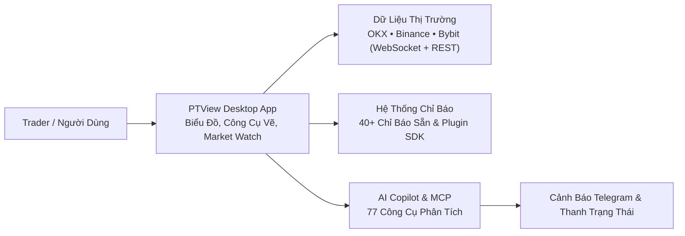

# Chào Mừng Đến Với PtView Workstation

**PTView** là phần mềm phân tích biểu đồ tiền mã hóa chạy trực tiếp trên Windows, được thiết kế dành cho Trader muốn tốc độ mượt mà chuẩn ứng dụng desktop, kết nối dữ liệu từ 3 sàn giao dịch hàng đầu (`OKX`, `Binance`, `Bybit`) và tích hợp sẵn trợ lý **AI Copilot** ngay cạnh biểu đồ — không lag trình duyệt, không cần cài thêm phần mềm trung gian.

:::tip Lần đầu dùng PTView?
Xem ngay **[Hướng Dẫn Bắt Đầu Nhanh (5 Phút)](quickstart.md)** để tải app, chọn sàn, mở biểu đồ đầu tiên, gắn chỉ báo và kích hoạt AI Copilot chỉ trong vài bước đơn giản.
:::

---

## Những Điểm Nổi Bật Dành Cho Bạn

### 1. Biểu Đồ Mượt 60 FPS — Không Giật Lag Trình Duyệt
- Là ứng dụng Windows thuần (`.NET 10` WPF) dựng đồ họa trực tiếp, không nhúng trình duyệt web nên tiết kiệm RAM và cuộn nến cực kỳ mượt.
- Hỗ trợ **nhiều Tab làm việc (Multi-Tab)** và chia **tối đa 4 biểu đồ trong mỗi Tab** (`1 biểu đồ`, `2 chia đôi`, `3 biểu đồ`, `Lưới 2×2`), tích hợp **Đồng bộ mã (Sync Symbol)**, **Đồng bộ con trỏ 2 chiều (Sync Crosshair)** giữa các khung giờ và chụp ảnh 4K gắn watermark bằng <kbd>Ctrl</kbd> + <kbd>Shift</kbd> + <kbd>S</kbd>.

### 2. Dữ Liệu Thời Gian Thực Từ 3 Sàn Crypto Hàng Đầu
- Theo dõi nến, biến động 24h và sổ lệnh từ **`OKX`**, **`Binance`**, và **`Bybit`** (Spot, Perpetual và Hợp đồng kỳ hạn).
- **Không cần nhập API key sàn giao dịch** vẫn xem biểu đồ và phân tích bình thường.

### 3. Trợ Lý AI Copilot & Theo Dõi Tự Động (`/schedule`)
- Nhấn <kbd>Ctrl</kbd> + <kbd>J</kbd> để chat với AI ngay cạnh biểu đồ: hỏi xu hướng, tự động thêm EMA/RSI, kẻ vùng hỗ trợ/kháng cự.
- Dùng lệnh `/schedule` để hẹn AI tự kiểm tra thị trường định kỳ và gửi cảnh báo về **Telegram**.
- Kết nối thẳng với **VS Code Copilot**, **Cursor**, **Claude Desktop**, hoặc **Antigravity** qua **MCP Server (77 công cụ)**.

### 4. Kho Chỉ Báo Phong Phú & Mở Rộng Bằng `PTView.SDK`
- Tích hợp sẵn **hơn 40 chỉ báo phổ biến** (EMA, SMA, SuperTrend, Bollinger Bands, Ichimoku, RSI, MACD, VWAP, v.v.).
- Lập trình viên có thể viết thêm chỉ báo C# tùy biến bằng `PTView.SDK` chạy cô lập an toàn ngoài tiến trình chính.

---

## Tổng Quan Luồng Hoạt Động

---

## Bạn Muốn Bắt Đầu Từ Đâu?

| Nhu cầu của bạn | Xem ngay tại đây |
|---|---|
| **Cài đặt & mở biểu đồ đầu tiên trong 5 phút** | [Bắt Đầu Nhanh Trong 5 Phút](quickstart.md) |
| **So sánh bản Community (Miễn phí) và Pro (Dùng thử 28 ngày)** | [Phiên Bản & Kênh Cập Nhật](editions-and-channels.md) |
| **Làm chủ Market Watch, Navigator, Bố cục & Zoom** | [Hướng Dẫn Giao Diện Workstation](app/workstation-ui.md) |
| **Cách lấy API Key Gemini / OpenAI / Ollama gắn vào AI** | [Đăng Ký & Gắn API Key AI](app/ai-api-keys-setup.md) |
| **Cách tạo Bot Telegram `@BotFather` nhận cảnh báo** | [Tạo & Gắn Bot Telegram](app/telegram-bot-setup.md) |
| **Sử dụng AI Copilot & Lệnh `/schedule`** | [AI Copilot & Lệnh Chat](app/ai-copilot.md) |
| **Sửa lỗi chặn mạng bằng Proxy hoặc xuất file Log hỗ trợ** | [Xử Lý Sự Cố & FAQ](app/troubleshooting-and-faq.md) |
| **Tự lập trình chỉ báo bằng C#** | [Hướng Dẫn PTView.SDK](sdk/getting-started.md) |
