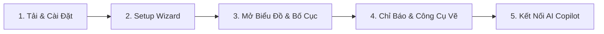

# Hướng Dẫn Bắt Đầu Nhanh (5 Phút)

Lần đầu sử dụng **PtView Workstation**? Chỉ cần làm theo 5 bước đơn giản dưới đây để cài đặt, mở biểu đồ coin trực tiếp, gắn chỉ báo và chạy phân tích AI đầu tiên.

---

## Bước 1: Tải & Cài Đặt (Windows)

1. Truy cập **[Trang Phát Hành PTView](https://github.com/vntradesoft/ptview-releases/releases)** và chọn tải:
   - **`PTViewWorkstation-win-Setup.exe`** *(Khuyên dùng)* — Cài đặt 1-click, tự động cập nhật nền và tạo shortcut ngoài Desktop/Start Menu.
   - **`PTViewWorkstation-win-Portable.zip`** — Giải nén ra thư mục bất kỳ và chạy thẳng `PTView.Desktop.exe` (tiện mang theo USB hoặc máy công ty).
2. Chạy file cài đặt — không cần quyền Administrator.

:::tip Lưu ý nếu Windows SmartScreen hiện cảnh báo
Với các bản Beta mới phát hành, nếu Windows hiện hộp thoại **"Windows protected your PC"**, hãy bấm **More info** → **Run anyway**. Mã kiểm tra SHA-256 của mọi file đều được công khai trong `checksums-sha256.txt` ở mỗi bản phát hành.
:::

---

## Bước 2: Hoàn Tất Setup Wizard Lần Đầu

Khi mở ứng dụng lần đầu, **Setup Wizard** sẽ dẫn bạn qua 4 bước ngắn:
1. **Giao diện & Ngôn ngữ**: Chọn **Tiếng Việt** hoặc **English**, chọn giao diện (**Dark**, **Midnight OLED**, **CyberNavy**, **Light**) và màu nhấn.
2. **Điều khoản & Miễn trừ rủi ro**: Đọc và tick xác nhận cả 2 mục bắt buộc.
3. **Sàn giao dịch & Mặc định**: `OKX`, `Binance` và `Bybit` đều được kích hoạt sẵn — bạn có thể giữ cả 3 sàn hoặc tắt bớt sàn không sử dụng.
4. **Hoàn tất**: Bấm **Finish** để vào thẳng bàn làm việc kèm **28 ngày dùng thử Pro miễn phí**.

---

## Bước 3: Chọn Cặp Coin, Khung Giờ & Bố Cục Đa Biểu Đồ

1. **Đổi Sàn**: Chọn sàn ở góc trên bên trái thanh công cụ (hoặc lọc trực tiếp trong bảng **Market Watch** `Ctrl+M`).
2. **Tìm Mã Nhanh (`Ctrl+K`)**: Nhấn `Ctrl+K` (hoặc bấm vào nút tên cặp coin trên toolbar), gõ `BTC`, `ETH`, `SOL` rồi chọn **Spot** hoặc **Perp**.
3. **Đổi Khung Thời Gian**: Bấm nhanh `1m`, `5m`, `15m`, `30m`, `1h`, `4h`, `1d` trên thanh công cụ — hoặc bấm mũi tên `v` để ghim thêm khung giờ yêu thích.
4. **Chia Nhiều Biểu Đồ**: Bấm các nút bố cục trên toolbar để chia **1 Biểu đồ**, **2 Chia dọc/ngang**, **3 Biểu đồ**, hoặc **Lưới 2×2** (hỗ trợ trong Trial 28 ngày / Pro).

---

## Bước 4: Gắn Chỉ Báo & Vẽ Phân Tích Kỹ Thuật

- **Thêm Chỉ Báo (`Ctrl+I`)**: Nhấn `Ctrl+I`, gõ `EMA`, `RSI`, `MACD`, `Bollinger` rồi nhấn `Enter`; hoặc mở bảng **Navigator** (`Ctrl+Shift+N`) để kéo/gắn từ danh mục.
- **Vẽ Đường Xu Hướng / Vùng Giá**: Chọn công cụ ở **Thanh Công Cụ Vẽ bên trái biểu đồ** (Trend Line, Đường ngang, Vùng chữ nhật, Fibonacci). Bật **Magnet Mode** để bắt dính chính xác vào đỉnh/đáy nến.
- **Phóng To / Thu Nhỏ**: Cuộn chuột trên biểu đồ, kéo trực tiếp trục giá hoặc trục thời gian, hoặc giữ `Alt+Kéo chuột` để khoanh vùng phóng to (**Box Zoom**). Nhấn `Ctrl+0` để tự động căn lại toàn khung.

---

## Bước 5: Tùy Chọn — Bật Trợ Lý AI Copilot (`Ctrl+J`)

1. Vào **Tools → AI Settings** và bấm **Add** ở tab **AI Accounts** (xem hướng dẫn chi tiết từng bước cho Gemini Free, OpenAI, DeepSeek, hoặc Ollama offline tại **[Đăng Ký & Gắn API Key AI](app/ai-api-keys-setup.md)**).
2. *(Tùy chọn)* Tạo Bot Telegram nhận cảnh báo trong 2 phút: **[Tạo & Gắn Bot Telegram](app/telegram-bot-setup.md)**.
3. Nhấn `Ctrl+J` để mở bảng **AI Copilot** bên phải và chat bằng tiếng Việt tự nhiên:
   - *"Phân tích xu hướng H1 hiện tại và vẽ giúp mình vùng hỗ trợ/kháng cự chính."*
   - *"`/schedule` every 15m kiểm tra RSI và funding rate --notify"*

:::info An Toàn Tuyệt Đối (Chỉ Đọc)
AI Copilot chỉ đọc dữ liệu giá và vẽ/phân tích trên biểu đồ — **tuyệt đối không có quyền đặt lệnh hay truy cập tài sản trên sàn**. Bạn cũng **không cần nhập API key sàn giao dịch** chỉ để xem chart và phân tích AI.
:::

